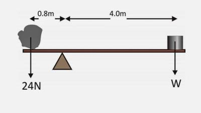

## Loads, Reactions and Moments

### **The Basics**

* Reaction forces are usually added to structural members
* An example could be a Truss applying its mass onto the pillars that are holding it
* If an object is not moving (resting on these columns), the forces acting down are equal to those acting up.
* This is called **equilibrium** (“Every reaction has an opposite equal reaction”)
* Moments are turning forces

**The Notation**

* F(number) = It is the force acting down upon the object
* R1 = It is the left side of the reaction force (usually acting up)
* R2 = It is the right side of the reaction force (usually acting up)
* **Forces down are equal to forces acting up**

### **The Equation**

* The equation for working out Moments:
* **Moments = Force \* Distance**
* **(N/m)             (N)           (M)**
* Below is an example of a question (Moments):

 

### **Solution**

* We know from the diagram that the object is in equilibrium
* This means that R1 = R2 (left = right)
* We can work out the Moment on the left (since both the force and distance are given)
* Equation: **Moments = Force \* Distance**
* **(N/m)             (N)           (M)**
* So.. 0.8 \* 24 = 19.2
* Now we know that R1 = 19.2
* R2 has to be equal to that. This means that we can set up our equation as: 19.2= 4.0 \* W
* When we rearrange we get 19.2/4.0 = W
* W = 4.8 (N)

