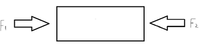
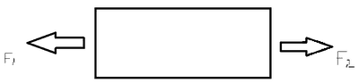
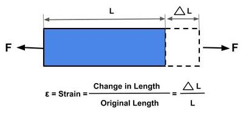
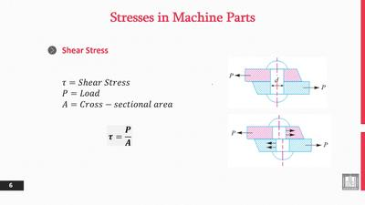
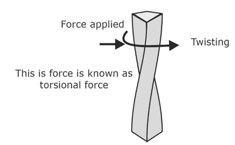

## Forces

### **Introduction**

* Forces are acting everywhere
* Constructions need to withstand forces
* The SI unit for a force is Newton (N)
* Forces can be either pushes or pulls
* Concepts of Stress or Strain can predict how a structure can work when a force is applied to it

### **2 Types of Forces**

* There are 2 types of forces
* Compression Force
* Tension Force
* Below is a diagram of a Compression Force acting on a block

 

* Below is a diagram of a Tension Force acting on a block

 

### **Strain**

* When forces are applied to the material, the material will change shape a bit
* This phenomenon is called strain
* The strain can be determined as:
* Strain = Change in length / Original length
* (keep in mind it is **usually** a tiny value)
* An example of strain can be the door handle being pulled open
* Below is a small diagram:

 

### **Stress**

* Stress is measured to predict when the object will fail (safety)
* Stress can be either the number of cycles an object can hold (ex. Number of hours an Airplane can fly until the steel hull is deemed to be too used due to constant stress)
* or the maximum mass the object can support (ex., a chair)
* Stress is derived via a formula:

  $$
  \text{Stress}=\frac{\text{Force}}{\text{Cross-sectional area (base x height)}}
  $$
* The units of stress are N/m^2
* Below is a diagram:

 

### **Shear and Torsional Forces**

* Torsional forces are twisting forces
* When a fracture is created, it usually produces a sliding-type failure

 