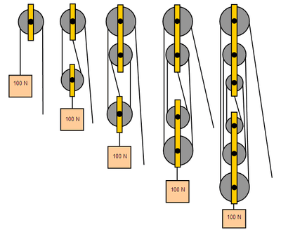
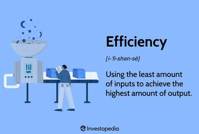

## Mechanisms

### **Introduction**

* Mechanisms are made up of moving parts
* Basic parts include: levers, fulcrums, gears..

Keep in mind that no mechanism is 100% efficient (friction, thermal energy, sound)

### **Mechanical Advantage**

* Mechanical advantage is how much a mechanism can increase human input strength by
* If you had a mechanical advantage of 4, it would lift 4 times the loads with the same strength
* **To determine the mechanical advantage of a pulley system, you count the number of wheels**
* The formula for mechanical advantage is 

  $$
  \text{MA}= \frac{\text{output forcw}}{\text{input force}}
  $$
* Below is an example of a pulley system:

 

**Velocity Ratio**

* Velocity ratio is the same as mechanical advantage but with moving parts (gears and belts)
* It determines what the output speed of a gear chain will be given the number of teeth and rpm (Rotations per minute)
* The formula for the Velocity Ratio is

  $$
  \text{VR}=\frac{\text{distance moved by effort}}{\text{distance moved by load}}
  $$

### **Efficiency**

* No mechanism is 100% efficient
* Energy (input) is lost in the process (via friction, heat, sound)
* To calculate efficiency the formula is: 

  $$
  \text{Efficiency}=\frac{\text{output work}}{\text{input work}}\text{ x100}
  $$

 