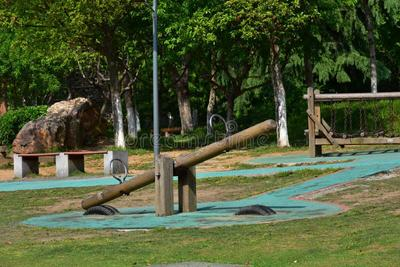
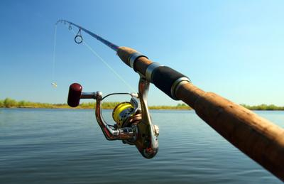

## Levers

### **Levers (Load, Effort, Fulcrum)**

* The formula for the mechanical advantage in a lever is: **MA = length of left side/length of right side (or the other way around, depending on where the effort is)**
* There are 3 types of Levers.
* EFL (Effort, Fulcrum, Load) → This is a type 1 lever. This is the most common typical lever. An example would be a seesaw.
* ELF (Effort, Load, Fulcrum) → This is a type 2 lever where the fulcrum is located on the end. An example would be a wheelbarrow.
* FLE (Fulcrum, Load, Effort) → This is a type 3 lever. The fulcrum and load are located at the ends, with the effort going in the middle. An example would be a fishing rod.
* **Below is an example of a Type 1 lever:**

 

* **Below is a Type 2 lever:**

 

* **Below is a Type 3 lever:**

 