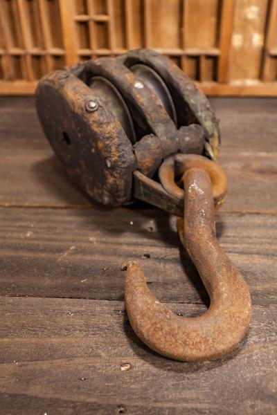
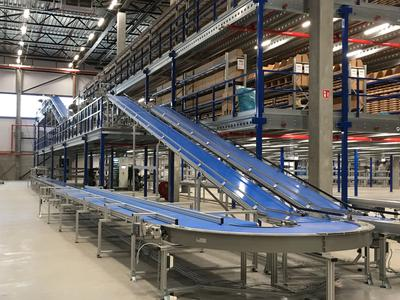

## Pulleys and Belts

### **Pulleys**

* Pulleys are mechanical systems that make it easier to move objects
* Pulleys are commonly used in cranes
* **To find the** **mechanical advantage of a pulley, you count the number of wheels**
* If you have 3 wheels, you will have a mechanical advantage of 3 (but also will use 3 times more rope)
* Below is an example of a pulley system:

 

### **Belts**

* Belts are similar to Pulleys and gears
* You must remember that if the belt crosses the direction of turning changes
* **The formula is: VR (Velocity Ratio) = Diameter of the Driven pulley / Diameter of the Driver pulley**
* Below is an example of a belt system:

 