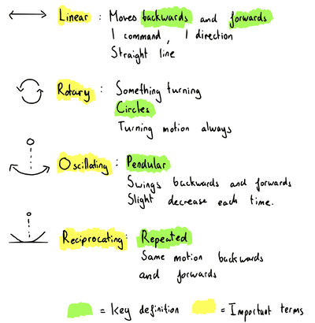

## Conversion of Motion

### **The Basics**

* There are 4 types of conversions of motion
  * Rotary → Rotates in a Circle
  * Linear → In a straight line
  * Reciprocating → Like a pendulum, the same motion without decrease
  * Oscillating → Like a pendulum but decreases every time
* Below is a diagram with annotation that explains the 4 types:

 