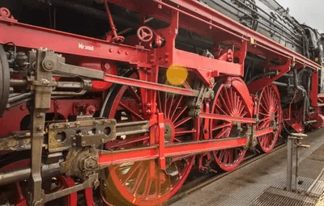
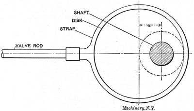
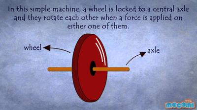
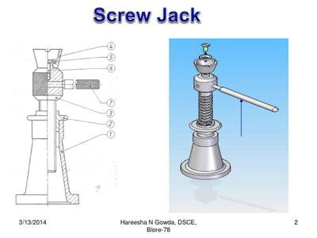
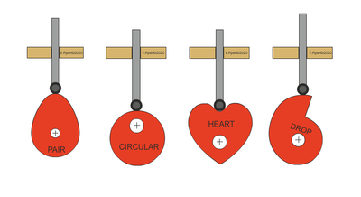

## Crank and Slider, Cams, Screw Threads and Wheel Axes

### **Crank and Slider**

* It is a mechanism used to convert from rotary motion to linear motion
* As the crank (turning thing) rotates, the slider (linear) slides back and front
* Below is an image to show a crank and slider:  

### **Eccentrics**

* It’s similar to a crank and slider and converts rotary motion to linear motion
* It is commonly used in Engines
* Below is a picture of an Eccentrics:

 

### **Wheel and Axle**

* The wheel and axle change the axis of rotation
* It is commonly used in locomotive and car engine
* It is also used to Transmit a load to a smaller wheel
* Below is an image of such a mechanism:

 

### **Screw Thread**

* Screw threads are again converting rotary to linear
* They are commonly used in shipbuilding
* When you turn the handle, the screw screws in
* The velocity ratio (VR) is calculated with a formula:

  $$
  \text{VR}=\frac{\text{distance moved by effort}}{\text{distance moved by load}}
  $$

 

### **Cams**

* Cams are also transferring rotary to linear motion
* They are made of  3 parts: the shaft, the cam and the follower
* The Camshaft turns the cam
* The follower goes along the cam's surface and, depending on the gradient of the cam, goes either up or down.
* This motion is repeated every time the cam does a circle
* The output of the follower will largely depend on the shape of the cam
* Cams are manufactured out of different materials..wood,  metal, etc..
* They are commonly used in car engine blocks and wooden kids’ toys

**The Cam performs 3 basic actions:**

* A Rise: Follower moves up
* A Fall: Follower moves down
* A Dwell: Follower doesn’t rise nor fall
* Below is a diagram of the most common cams:

 