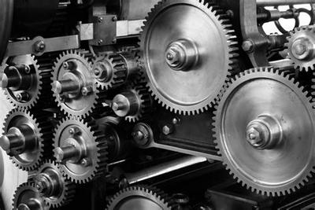
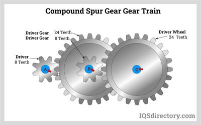
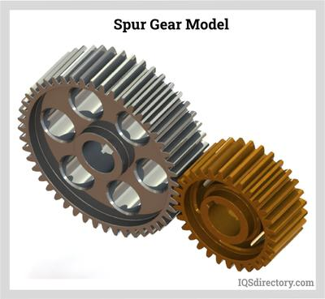
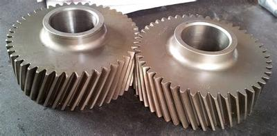
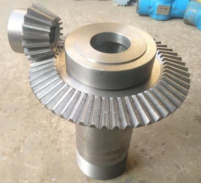
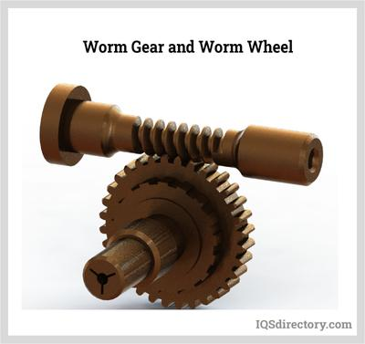
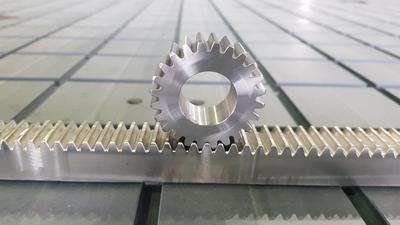
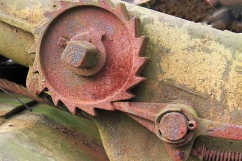

## Transmission of Motion

### **Introduction**

* Motion has to be transferred over distances
* This is done via..pulleys, gears, racks and pinions
* It is also important to transfer motion from vertical to horizontal (or vice versa)

### **Gears**

* Gears are everywhere; they are in gearboxes and bicycles
* Gears can transmit motion very easily
* A gear system is multiple gears all connected
* The idler is a gear that is not powered by a motor (it spins because of the other gears)
* Gears are good because they can reduce the ratio in a small space
* Gears can also change the axis of rotation (vertical from horizontal)
* Gears have teeth and are spinning on shafts
* The driver gear is the gear that is being spun by the motor
* The formula to work out the Velocity Ratio (VR) is:
* VR = Number of teeth on the driven gear / Number of teeth on the driver

 

**Compound Gear Trains**

* Compound gear trains have multiple gears placed together (ex. 4-5)
* **The way a gear train is calculated is that you calculate the velocity ratio between every pair of gears**
* **Then, you have to multiply them together**

 

### **Torque**

* Torque is the turning force of a gear system
* It is calculated using the formula:
* VR = output torque/input torque

### **Types of Gears**

* There are many different types of gears so that they can perform various functions.

### **Spur Gears**

* These are the most common gears
* They are just flat and straight gears
* They can reach very high speeds
* They can be made out of different materials, such as nylon or steel
* An issue with them is that they are very loud due to the vibrations between the teeth

 

### **Helical Gears**

* Helical gears are similar to spur gears, but the teeth are placed at an angle.
* This largely reduces sounds and vibration
* They can also withstand heavier loads
* In all other characteristics, such as material, they are very similar

 

### **Bevel Gears**

* Bevel gears change the axis of rotation
* They are like helical gears but are connected at a 90-degree angle

 

### **Worm Gears**

* Worm gears are gears with only 1 tooth
* The tooth spins around the entire metal rod
* They can be reduced to extremely small spaces
* They can also change the axis of rotation
* The formula for the velocity ratio in a worm gear:

  $$
  \text{VR}=\frac{\text{number of teeth on worm wheel (wheel connected to the worm gear)}}{1}
  
  $$

 

### **Rack and Pinion**

* They are used to convert from linear to rotary motion
* The spur gear is called the rack
* The flat belt with teeth is called the pinion
* When the Spur gear rotates, the crank slides backwards and forwards
* The formula for the velocity relationship is:
* VR = number of teeth on the pinion/number of teeth on the rack

 

### **Ratchet and Pawn**

* This allows rotation in 1 direction only
* It prevents completely the rotation in the opposite direction

 