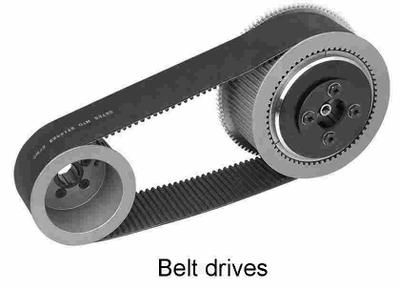
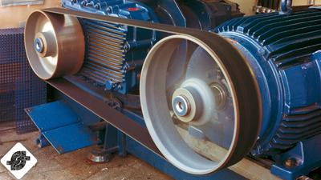
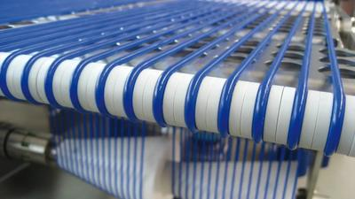
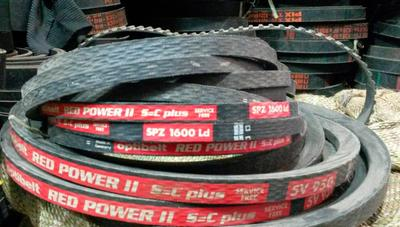
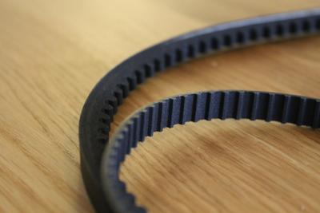

## Transmission of Motion - Belts

### **Belt Drives**

* They are used to link 2 shafts over long distances
* Belt shafts are usually parallel to each other
* If the belt is crossed between the shafts, the direction of turning will be reversed.
* If it isn’t crossed then it will spin in the same direction as the motor
* Belt drives tend to be cheaper than gear systems (less materials)
* However, the belts can stress and slip, then can also stretch a bit

 

### **Belt Drives Formulas**

* **Torque**
  * $\text{Velocity Ratio (VR)}= \frac{\text{output torque}}{\text{input torque}}$
* **Velocity Ratio**
  * $\text{Velocity Ratio (VR)}= \frac{\text{diameter of driven pulley}}{\text{diameter of the driver pulley}}$

### **Different Belt Types**

### **Flat Belts**

* These are the most basic belts
* They are flat and simple
* They are commonly used in household applications

 

### **Round Belts**

* Round belts have a circular cross-section
* They are used for low-power transmissions
* When the belt rotates it presses against the sides of the wheels, making it secure.

 

### **Vee-Belts**

* They are used where high transmission forces are required
* They do not slip
* They can support high loads at high speeds

 

### **Toothed Belt**

* These belts have teeth to prevent slipping
* They are commonly used in car engines
* They also allow more synchronisation

 