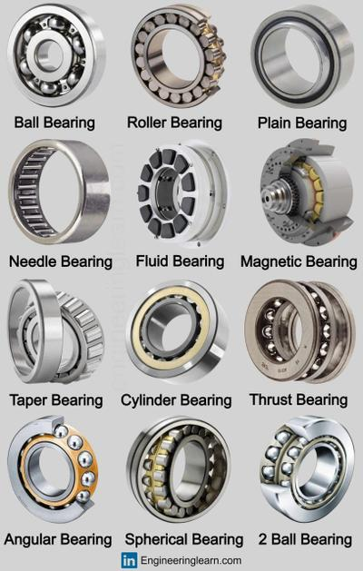
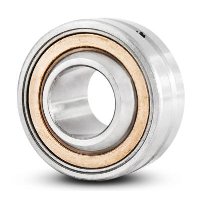
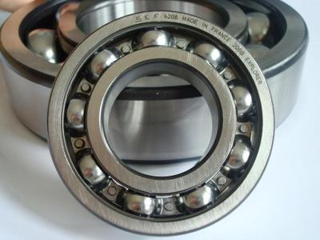
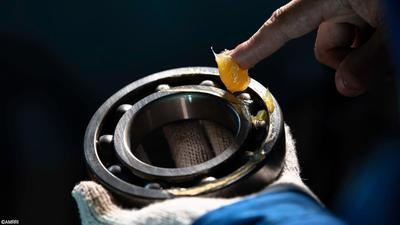

## Bearings

### **Introduction**

* When materials rub together, friction is created
* Friction wears off the components
* It produces heat and reduces the life span of an object
* This is combated via bearings and lubrication

### **Bearings**

* Bearings reduce friction
* There are 2 main types of bearings
* Usually, there are 2 layers to a bearing and something in between
* These layers spin around the centre layer, reducing friction

 

### **Plain Bearings**

* These are the most basic bearings
* They have no rolling components
* They have the 2 layers (brass or bronze)

 

### **Ball Bearings**

* Ball bearings are the most common
* They have rolling balls that spin to reduce tension
* They can be sealed to reduce maintenance
* The balls are usually made out of aluminum or steel

 

### **Lubrication**

* Lubrication is added to increase the performance of components and to reduce friction.
* Lubrication can be grease or oil (these are the 2 more common ones)
* It is important to commonly check the parts for any frictional damage and add lubrication

 