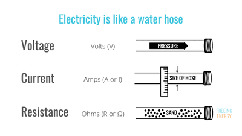
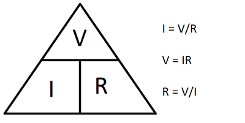
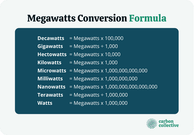
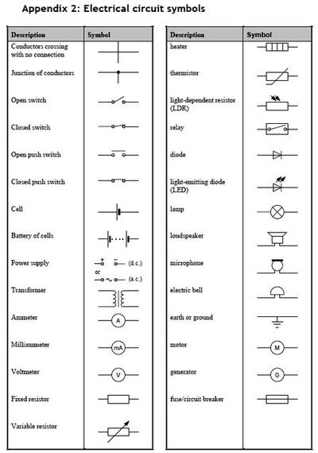
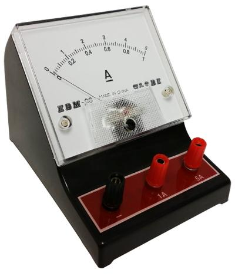
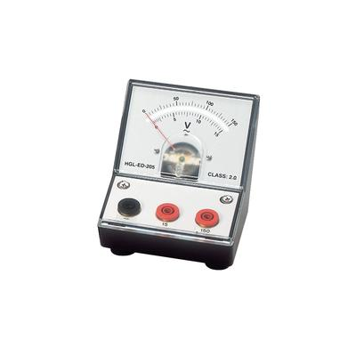
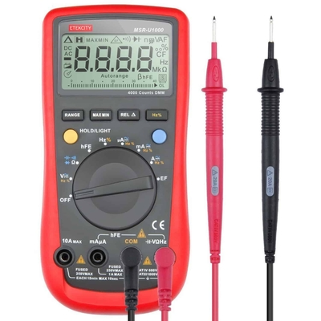

# Electronics

## Voltage, Current, Potential Difference, Symbols and Measuring

### **Voltage**

* Voltage is the energy supplied by the batteries
* The higher the energy supply the higher the voltage

 

### **Potential Difference**

* Potential Difference is what slows down the current
* It is like the friction
* It can be measured using a voltmeter which is attached in Parallel

### **The Equation**

* The equation is called Ohm’s law
* It is defined as a triangular equation
* The equation is:
* Voltage (V) = Current (I) \* Potential Different (R)

 

### **Power**

* The equation for power is:
* Power = Voltage \* Current
* The unit of power is Watts (W)
* 1 Killowatt is 1000 Watts
* 1 Megawatt is 1000 Kilowatts

 

### **Table of Electronic Symbols**

* Below is a table of most electronic symbols you need to know:

 

### **Measuring Voltage, Current, and Resistance**

* Ammeters measure the Current (I); they are placed in series
* Voltmeters measure the Voltage (V); they are placed in parallel
* These meters can be either analog or digital
* Digital offers a more accurate value
* However, analog are less likely to break or produce errors
* Multimeters can measure both voltage and current with 1 device however, these need to be charged as they have a battery
* They are more versatile
* Below is a picture of an Ammeter:

 

* Below is a picture of a Voltmeter:

 

### **Multimeters**

* Multimeters measure the Voltage and Current
* They are a multi-purpose device that measure electric properties
* You can switch between modes to select what you want to measure (Voltage, Current and Resistance)
* They are usually digital however analog ones do exist
* Sometimes they offer additional properties such as measuring the temperature
* Below is a picture of a digital multimeter:
