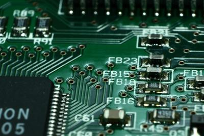
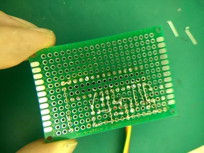

## Circuit Boards

### **Introduction**

* Circuit Board are effective at mounting components at a close proximity
* They can be mass-produced simply
* The components are also close together, which reduces transmission times

 

### **Circuit Board Printing**

* The process is simple
* A thin sheet of copper is placed on a baseboard
* It is attached via an adhesive
* They can be either double-sided or single-sided (price, where they will be used?)
* Then, the holes for the components are drilled, and the components are inserted
* This can be mass-produced
* Below is a simple video on creating a Circuit Board:
* <https://www.youtube.com/watch?v=o8NOK1JJbgw>

### **Designing Circuit Boards**

### **Procedures**

* A circuit board is designed using specialized software
* It is designed using block diagrams
* It usually starts with the dimensions of the main board to make sure that the base is correctly sized.
* Circuit diagrams can also be designed by hand.
* Prototypes are also commonly made to test the boards before they go into mass production.

**Below is an image of a prototype board:**

 