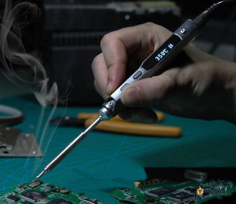
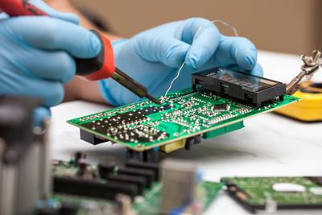

## Soldering

### **Introduction**

* Soldering is commonly used during the manufacture of PCB boards
* Solder is made out of metals like brass that melt at low temperatures (200 Degrees C)
* Soldering is used to attach components onto a PCB board
* It is done using a soldering iron
* Below is an image of a soldering iron:

 

### **Soldering Method**

* The board and components have to be heated to a high temperature
* A bit of solder is placed
* The solder is then melted using a solder iron
* The solder is placed into the joint between the components
* Excess solder is removed using a de-soldering tool

 

### **Safety Points**

* The soldering iron is hot. Do not touch it
* Avoid breathing in fumes
* Wash your hands if any solder gets onto them
* Make sure the solder is away from children
* Check the soldering iron for damages

