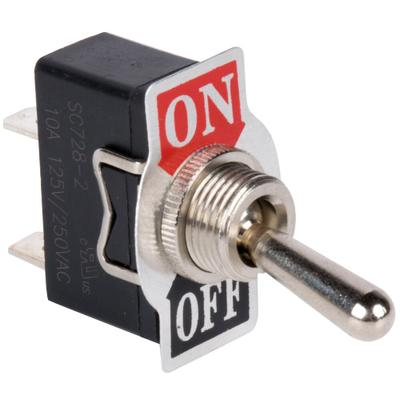
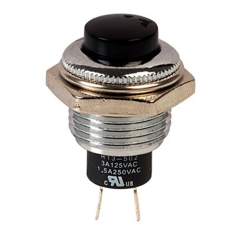
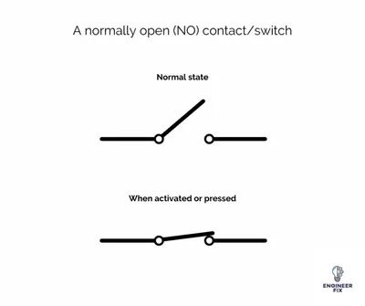

## Switches

### **Introduction**

* Circuits have many different components
* Each component is designed to do a special function

### **Switches**

* A switch is designed to break the flow of electrons in a circuit
* There are many different types of switches
* The most common type of switches is the Toggle switch
* Below is a image of a Toggle switch

 

### **Press to Make & Press to Make Switches**

* PM and PB switches are manual switches that require a button pressed to break or make a circuit
* Below is a diagram of a Press to Break Switch

 

### **Normally Open & Normally Closed Switches**

* NO and NC switches are either normally open or closed
* They only do the opposite if a signal or force is applied
* They are similar to the gate to the house. It only needs to be open when a command is sent
* Below is an example of a NO switch:

### **Different Types of Pole Switches**

* The poles in a switch are the number of different circuits it can operate at the same time
* There are 2 main type
* Single Pole & Double Pole
* Single Pole is the simplest, it is just 1 input and 1 output (on or off)
* A Double Pole can operate between 2 circuits and switch the current into either 1 or the other
* Here is a video link to help you understand Pole Switches: <https://www.youtube.com/watch?v=74bTFqLXYdQ> (it shows how a double pole works

