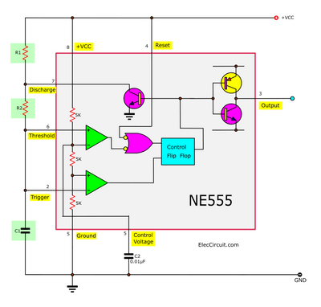
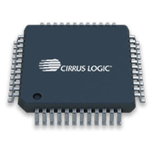

## Time Delay Switches
### **The Basics**
* Time delay switches are made of discrete components
* They are made of Bulbs, resistors, capacitors and more
* Many are designed on Computer Software as it is simple to test and alter
* The formula to calculate the time delay is:
* Time Delay = Resistance (OHMS) * Capacitance (FARADS)
* This is the formula for a resistor-capacitor circuit (which is the most common one)

### **Integrated circuits**
* Integrated circuits have undergone a lot of development in the past few years
* They are often made of semi-conductor material such as Silicon
* They are called "chips" or "chipsets"
* They have many advantages such as:
* Being reliable
* Taking up less space than traditional circuits
* Power efficient

### **555-Timer Integrated Circuits**
* First ever circuit for Time delay
* 8 pin package
* Either a monostable timer or Astable timer
* Please watch a video about the diagrams in the resources chapter as it is easier to see that way
* Below is an image of a 555-Timer Integrated Circuit:
 

### **Programmable ICs**
* They can be programmed to carry out various tasks
* They are found of most electronic products such a Tablets
* They are made with various LOGIC GATES and can be reprogrammed for the desire of the user
* They have few components
* They are low cost
* The user needs programming skills
* Precise Voltage is needed for it to work
* Standardised in the basics
* Below is a picture of a IC:
 