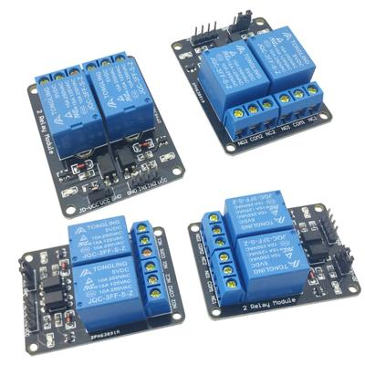
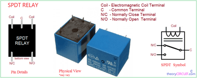

## Relays

* Relays are turned on and off via an electromagnet
* When the magnet is activated in brings together the two contacts turning the circuit on
* When the magnet is off the contacts will separate cutting the circuit
* They are useful as they can operate at a range of voltages
* Below is a diagram of a relay (switch):

 

### **SPDT Relay**

* It connects 1 input to 2 outputs
* It again uses an electromagnet with a coil that when turned on brings together the contacts
* It has 5 terminals
* It allows 2 circuits to be controlled with only 1 input
* Below is a diagram of a SPDT Relay:

 