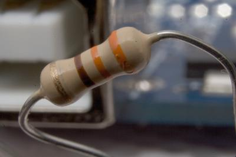
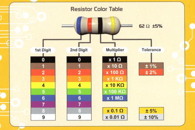
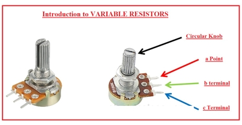

## Resistors

* The unit of resistance is: Ohm’s (**Ω)**
* Resistors reduce the flow of electrical current
* They act as friction
* They produce a lot of heat
* Variable resistors can vary the resistance value
* Below is a picture of a resistor:

 

### **Colour codes of Resistors**

* A colour code is used to distinguish between resistor strengths
* Different colours represent the total resistance of a resistor
* Below is a diagram that explains the colour codes:

 

* Below is an amazing video that explains how to calculate the resistance based on these colours:
* <https://www.youtube.com/watch?v=G1mZutobxDU>

### **Tolerance**

* Each resistor is slightly different (it's like the gambling game with CPU chip silicon)
* So the manufacturer gives a percentage error offset for the resistor
* It is either 2%, 5% or 10% 
* This depends on the final band colour of the resistors (red, gold, silver)

### **Calculations in fixed resistors (in Series)**

* When you have multiple resistors one after the other
* And you know the values of each resistor (in ohms)
* You can just add up all the resistors together to get the final resistance values at the end
* Ex. 200+100+80 = 380 Ohms of resistance

### **Calculations in Fixed Resistors (in Parallel)**
* When calculating resistance in parallel we use a formula:
* The formula is R1 * R2*.. (All the resistors you have) / R1 + R2 +... (All the resistors you have)
* Keep in mind that you have to multiply the resistance of the resistor together 

### **Potential Divider**
* The resistors divide the supply of voltage into smaller values
* The total output of all the resistors **SHOULD** add up to the input voltage
* The formula to calculate the output voltage is:
* VoltageOutput = R2 (in series) /  (R1 + R2) * VoltageIn

### **Variable Resistors**
* These resistors change the resistance based on what the user wants
* They have a turning spindle that when turned varies the resistance
* Below is a picture of a variable resistors:
