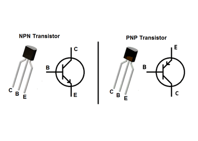
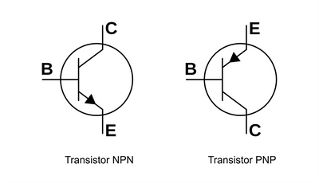

## Transistors

### **Introduction**
* A transistor is both a switch and an amplifier
* It has 2 connections, these are: Base, Emitter and Collector
* If connected incorrectly the resistor will be damaged
* Below is a picture of Transistor:

### **How a Transistor operates:**
* It is similar to a tap. When a small current flows through the base (this is called the base current), it allows a greater current to flow from the collector to the emitter.
* It simply acts a gate or a permission manager. If a small current flows it validates and allows a greater current to flow.

### **NPN Transistors**
* NPN means Negative - Positive - Negative
* It is one of 2 types (NPN and PNP)
* The actual name for a NPN Transistor is a Bipolar Junction Transistor
* It is used for amplification (smaller current allows a larger one to flow (read #How a Transistor operates above))
* Please keep in mind that too high of a current & an incorrectly placed resistor will damage the resistor
* The legs of NPN transistors will be marked with different letters to make sure that they are placed correctly.
* They are marked with  e = emitter, b = base, c= collector.
* Below is the symbol for an NPN Transistor:

### **Transistor Switches**
* They operate in sensor circuits very commonly
* The sensor acts as the small base current which if activated turns on the main current
* An example is a gas sensor, if the gas level is too high then the sensor will send a small current through the base, which will then allow the sending of a larger current to power an indicator light or an alarm.