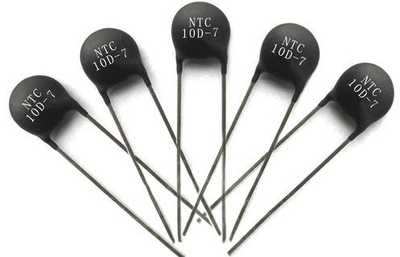

## Thermistor
* It is a resistor that changes resistance with temperature changes
* It can work both ways (Decrease temp = more resistance or the other way around)
* It usually works with a temperature control tool to make the resistance controllable
* Below is an Image of a Thermistor:
 