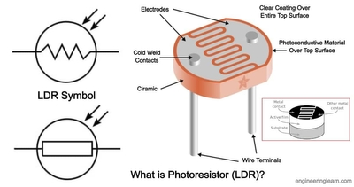

## Transducers
### **The Basics**
* Transducers are like variable resistors when a certain factor is involved (ex. Light)
* A Light Dependent Resistor (LDR) is a resistor that changes resistance with different light levels that are shined on it
* As the light intensity decreases the resistance also decreases
* It usually has an average resistance of 100 OHMS
* They are used to operate with light sensors and Light bulbs
* They are commonly seen in households and plantations (indoors)
* Below is an Image of a LDR:
 