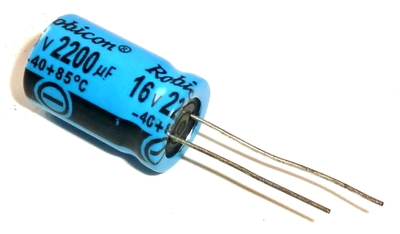
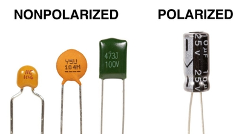
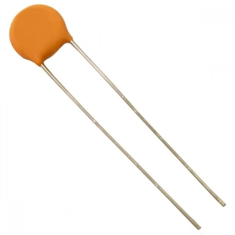

## Capacitors
### **The Basics**
* A capacitor is a small device that can store electrical energy
* They are used in timer circuits
* The unit is a Farad (F)
* Common units are: microfarads, nanofarads, picofarads (in order of becoming smaller)
* Below is an image of a capacitor:
 

### **Polarised Capacitors**
* They have a higher electrical storage value than Non Polarised
* They have a positive and negative terminal (Anode and Cathode), and because of that they have to be connected the "right" way in the circuit
* Electrolytic Capacitors and Tantalum-bead capacitors (types of capacitors) are all Polarised
* Below is an image of a Polarised Capacitor:

### **Non-Polarised Capacitor**
* They are smaller capacity-wise than Polarised
* They are named according to the material of manufacture
* The can be placed in series with a resistor to control the "speed" of the charge
* Below is an Image of a Non-Polarised Capacitor:
 