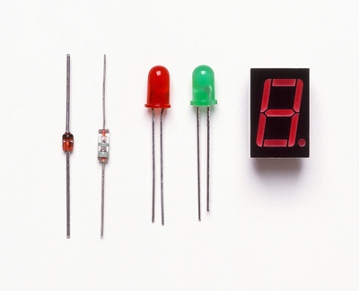
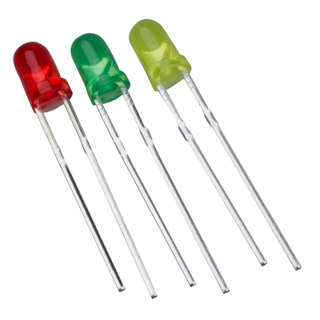
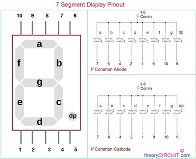
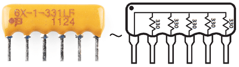

## Diodes

### **Introduction**
* A diode is a semiconductor that allows current to flow only in 1 direction
* Allowed direction = forward bias
* Not Allowed direction = reverse bias
* A diode has 2 leads (positive and negative)
* Below is an example image of a Diode:

* Diodes are used to prevent potential damage to transistors as they control the flow and direction of electricity

### **Light Emitting Diodes (LEDs)**
Basic LEDs
* An LED is a diode that gives out light
* It can emit various colours (up to 16.8 million combinations)
* They are used almost everywhere from kitchen lights to streetlights and Remote controls
* Usually the color of an LED is changed depending on the protective glass it is covered with
* LED's can vary in brightness, size and shape
* Fixed resistors are used to protect LED's from excessive current
* Below is an Image of an LED:

* For the calculation a variable of OHM's Law is used (R = V / I)

**Seven Segment Displays (SSD)**
* This is a display made out of 7 separate LEDs
* They are commonly used in clocks and digital radios
* They can represent all numbers by changing which LED will light up at which time
* Sometimes an 8th LED is used to show a decimal point
* Below is an image of a Seven Segment Display:

* A protective resistor (fixed) is needed to protect the LEDs
* Commonly a resistor array is used as it looks nice and is more efficient
* Below is an image of a Resistor array:
