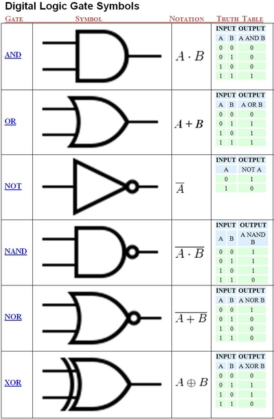
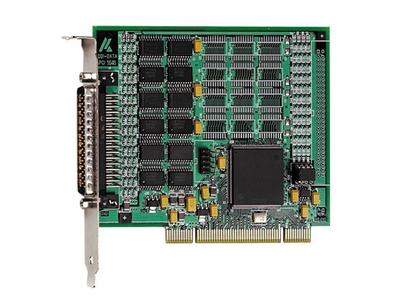
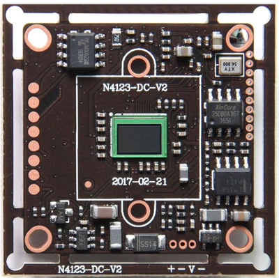
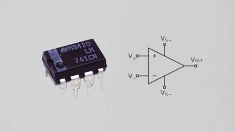
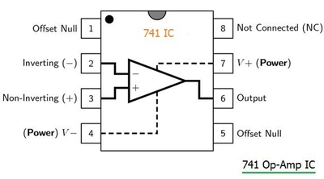
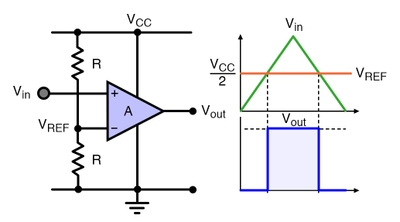

## Boolean Logic
### **Logic Gates**
* Logic gates are switches on a circuit board
* The gates that are needed for this course are: NOT, AND, NOT, NAND, OR, XOR (These are the same for Computer Science 0478 syllabus)
* Electricity can only be on or off. This means that binary wise they can only be a 1 or a 0
* Depending on what inputs there are and what gate it is the output is going to be different every time
* Each gate has a special symbol to it
* 1: There is a current running through the input or output
* 0 : There is no current running through the input or output
* Below are the truth tables of the logic gates and the gate symbols:
 
* It is important to memorize the symbols and the tables!

### **Integrated Circuit Logic Gate Families**
* They are available as a set type but have various differences between them
* The most common "Families" are CMOS and TTL
* TTL is known as the 74 series. They require a 5V supply and it has to be precise
* CMOS is known as the 4000 series. They require a 3-15V supply
* Most ICs used in school have 14-16 pins
* Below is an image of a TTL board:
 
* Below is an image of a CMOS board:
 
* Please watch the video in additional resources explaining each one of them

### **Logic Gate Systems in Everyday Life**
* Many Logic Gate systems are found in our daily life
* These include: Heating controls for houses, Alarms, Doorbells, Greenhouse temperature management systems
* Below is a video that shows some Logic Gate system examples and more Logic Gate things:
* https://www.youtube.com/watch?v=JQBRzsPhw2w

### **Operational Amplifiers (OP-AMPS)**
* They are used to amplify small input voltages
* They can also be used to compare voltages
* 741 OP-AMP is the most common Amplifier
* They are used in blood pressure measurement systems
* Below is an image of 741 OP-AMP:
 
* Below is an image referring to what the PINs in an OP-AMP do:
 
* The formula to calculate the voltage gain created by an Amplifier is:
* Voltage Gain = Change in output Voltage / Change in Input Voltage

### **OP-AMP used to Compare Voltage**
* It is often used as a comparator too
* It compares 2 input voltages at 2 different pins (usually PIN 2 and PIN 3)
* If PIN 2 has a greater voltage than PIN 3 then the output voltage will be close to 0 V
* They are used in Light Dependant Resistors
* Below is a diagram of a comparator (the right side can be ignored for the course)
 
 