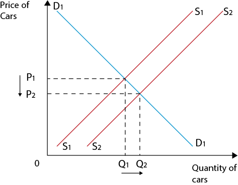

# 0455/22/F/M/20

## Section A

**1(a) Calculate India’s economic growth rate in 2017**

$$\frac{9362.5-8750.0}{8750.0} \times 100 = 7%$$

**1(b) Identify two methods of protection**

*Tariff and Quota*

**1(c) State why India is a mixed economy**

*Because it has both private sector and public sector*

**1(e) Draw a demand and supply diagram to show the effects of a decrease in the costs of production on the market for cars**

**1(f) Analyse the relationship between the size of countries’ primary sector output and GDP per head.**

*Countries with a higher GDP per head have a smaller primary sector, as the country develops it transitions resources into the secondary sector and as it further develops into the tertiary sector, as living standards improve and consumer demand for more goods and services this leads to the tertiary sector generating more income than the primary sector the US has only 1% for Primary sector output which is the smallest out of all the other countries whilst still having the highest GDP per head out of all With the exception being India, as India has a smaller sized primary sector but a lower GDP per head compared to Philippines which has a larger primary sector output and higher GDP per head than India*

**1(g) Discuss whether or not increasing subsidies given to bus travel would reduce pollution in India.**

*Subsidies will reduce the costs of production for bus travel, this increases the supply of buses in India and drastically lowers prices leading to higher demand, causing more people to use buses reducing congestion, and further reducing pollution in India.*

*However, there is an opportunity cost of subsiding bus travel as money could be spent on alternatives like campaign awareness and education to increase population understanding of the effects of pollution in India. Not all savings due to subsidies may be passed onto consumers in the form of lower prices, deterring people away from using buses as means of travel*

**1(h) Discuss whether or not India is likely to experience a deficit on the current account of its balance of payments in the future**

*India may experience a deficit on the current accounts of its balance of payments in the future as there is a deficit in both 2016 and 2017 respectively and is increasing after each year and is on an upward trend. It is also expected that the Indian exchange rate will rise this will cause the price of exports to increase causing demand for exports to fall due to not being internationally competitive. The price of imports may fall causing the demand for imported goods and services to rise. However, the lower tariff on imported raw material may reduce the costs of production for cars in India, causing the production of cars to rise more and cause more cars to be exported which reduces the likelihood of experiencing a deficit on the current accounts of its balance payments in the future as the countries export is now higher*

\n  \n * \n *

\