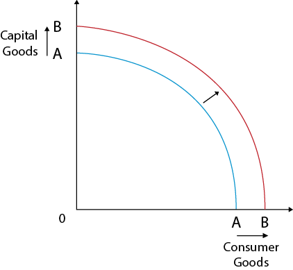

**2(a) State the formula for calculating the price elasticity of supply (PES).**

$$\frac{%Percent ,change ,in ,quantity ,supplied}{%,Percent ,change ,in ,price}\$$

\*\*2(b) Explain how opportunity cost is different for economic goods and free goods. \n \*\**Economic goods have an opportunity cost since they require resources to be produced and are available in limited in supply, therefore, are scarce, whilst free goods have no opportunity cost since they don’t require resources to be produced and are available in abundance and have no scarcity*

**2(c) Analyse, using a production possibility curve (PPC) diagram, the effect of an increase in enterprise on an economy.**

 

 \n 