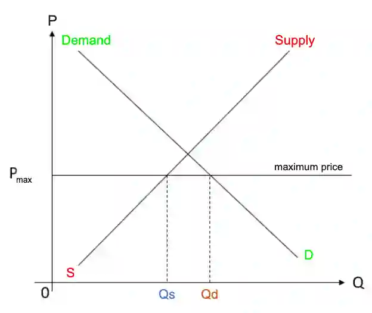

# 0455/22/F/M/25

## Question 1

**1(a)** $300 \text{bn} \times \frac{9}{100}$ = $27 \text{bn}$

**1(b)** Romania’s population fell due to a fall in the **birth rate** (number of live births per 1000 people in a population each year) and **emigration**.

**1(c)** Immigration may increase because higher wages and better living standards attract foreign workers, making it easier for them to find jobs and improve their quality of life.

**1(d)** Household spending has increased in Romania as there is more confidence in future prospects. They borrow more as they believe they will be able to earn more income and pay back the money in the future. Additionally, low interest rates encourage borrowing as when the borrowed money is paid back, there will be less interest to be paid (the cost of borrowing is less). However, as interest rates are lowered the reward to saving is less as less interest will be earned on money saved.

**1(e)**

**1(f)**

* **Relationship**: The higher the GDP per head, the lower the average household spending on food as a percentage of household income - they have a negative relationship.

* **Evidence**: The countries with the lowest GDP per head (Ethiopia, Cambodia, Egypt) had the three highest figures for household spending on food as a percentage of household income.

* **Analysis of relationship**: As the households become richer, they have more purchasing power and spend a lower percentage of on food and spend more on non-necessities. Higher GDP per head reduces the proportion of income spent on food.

* **Exception**: Norway had a higher GDP per head then US, and also a higher household spending on food as a percentage of household income.

**1(g)**

* MNCs may reduce poverty in their host countries as they provide job opportunities, so unemployed people can find jobs, increasing employment. Those who were in poverty may earn a higher income and be able to buy basic necessities, decreasing absolute poverty. The GDP may increase with the increased output, allowing more people to be able afford more goods and services. MNCs may be able to make use of economies of scale (lower average costs because they produce a large output), allowing them to charge lower prices so more people can afford goods and services.

* However, MNCs might not reduce poverty in their host countries as they may replace domestic firms. They may use capital-intensive methods of production, which will reduce the demand for unskilled labour. Workers, in domestic firms that get shut down or who are replaced by capital equipment, will be left unemployed with no income. They will not be able to afford basic necessities, increasing poverty. It may also turn into a monopoly and charge high prices, knowing that customers have to alternatives to switch to and will continue to buy from the MNC. Less people will be able to afford the goods and services produced by the MNC, increasing poverty.

**1(h)**

* A high proportion of women might enter Romania’s labour force in the future as there may be an increase in day care facilities, enabling more mothers to join the labour force as they will not have to take care of their children during working hours. The birth rate may decrease in the future, so less children will be born to women. Women with no children will be more likely to join the labour force as they can focus on their jobs and do not need to take care of children.

* However, women may face discrimination, limiting the number of jobs available for them and making it difficult for them to join the labour force. Negative social attitudes may continue to exist and other workers may make women feel uncomfortable in workplaces.