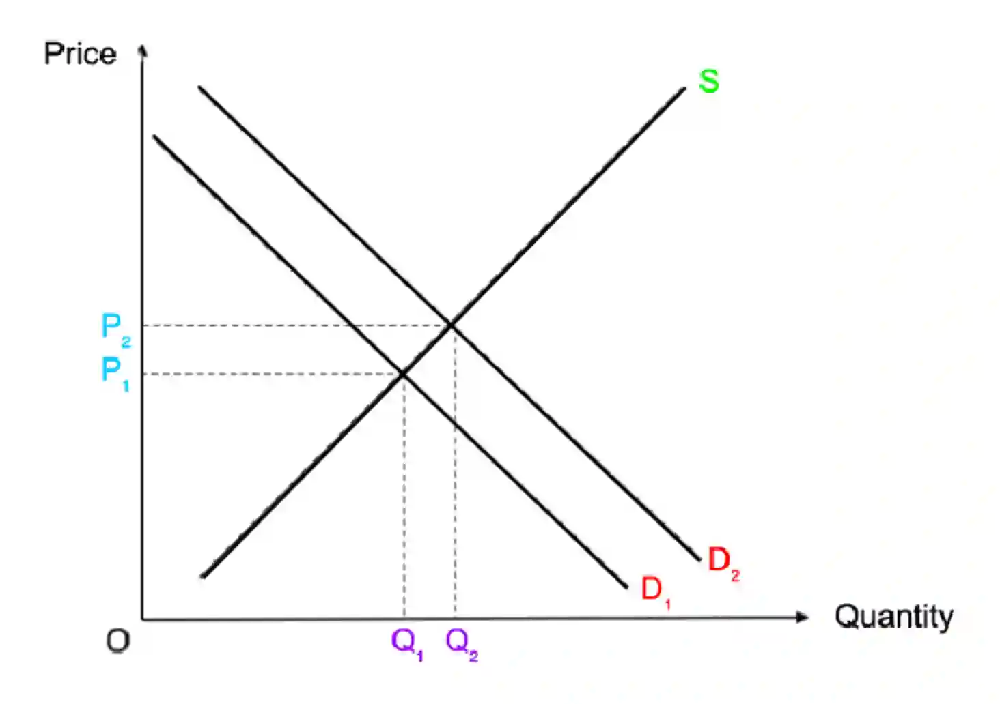

# 0455/22/O/N/24

## Question 1

**1(a)** $100\% - (79\% +2\%)$ = $19\%$

**1(b)** The current account balance of Jordan’s balance of payments include trade in services and primary income

**1(c)** The main type of unemployment is cyclical unemployment (demand deficient unemployment because total demand has fallen). This means that firms reduce their output and demand less labour, so the number of workers is greater than the number of jobs available.

**1(d)** There may be lower prices as as a result of economies of scale (lower average costs due to an increase in output produced), like purchasing economies (buying in bulk). Products may be of higher quality as diverse ideas can be shared and more collaboration can occur.

**1(e)**

* **Relationship**: Countries with a low birth rate are likely to have a high average age - they have an inverse relationship.

* **Evidence**: Monaco had the lowest birth rate and highest average age. Additionally, Niger had the highest birth rate and lowest average age.

* **Analysis of relationship**: A population of country with a low birth rate would have a smaller proportion of children, and a higher proportion of people aged over 65, increasing the average age of the population. A high birth rate may indicate poor living standards and therefore lower life expectancy.

* **Exception**: Maldives had a lower birth rate than Venezuela but both countries had the same average age.

**1(f)**

An increase in population size will cause an increase in demand for clothes, raising the price.

**1(g)**

* The Jordanian government should spend more on renewable energy because there is more need for energy due to increasing population size. Switching to renewable energy sources would reduce environmental damage (less carbon emissions) and external costs such as pollution. This could improve the health of the population. Additionally, it may be cheaper than non renewable energy in the long run, as solar and wind power are free goods.

* However, building the infrastructure needed to produce renewable energy, like wind turbines, could be expensive. Spending on renewable energy has an opportunity cost as the Jordanian government could instead spend on, for example, healthcare. Production of renewable energy may be disrupted by weather, and is therefore not reliable.

**1(h)**

* The Jordanian central bank should have raised the rate of interest in 2021 because it could have encouraged saving and discouraged spending. This is because more interest is earned if money is saved and more interest will have to paid if money is borrowed. Consumer expenditure and demand would have decreased, reducing demand-pull inflation.

* However, raising the rate of interest may discourage investment, lowering economic growth and causing unemployment as firms may shut down due to lack of demand. Additionally, the exchange rate may increase and import expenditure may increase, worsening the current account deficit.