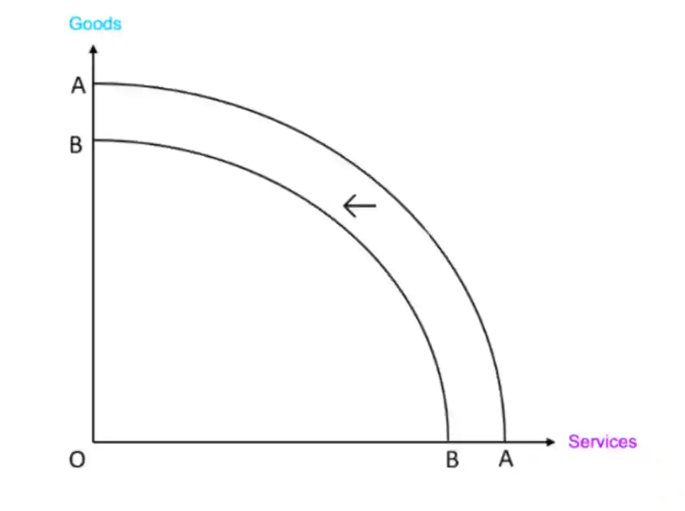

## Question 5

**5(a)** There may be fewer dependents and GDP per head may increase (GDP $\div$ population), if population size decreases.

**5(b)** If demand exceeds supply, price will rise, and then demand will fall. If supply exceeds demand, price will fall, and then supply will fall. These changes will then make demand equal to supply.

**5(c)**

A decrease in the size of the labour force reduces the factor of productions available, which will lower the productive capacity.

**5(d)**

* An increase in exports might benefit an economy as export revenue may increase, improving the current account balance. Total demand and economic growth may increase  as net exports increases. Firms may be encouraged to produce more output to export, so they will expand and hire more workers. More job opportunities may be created so unemployment may reduce and incomes may rise.

* However, exports raise total demand, and if total demand increases faster than total supply, demand-pull inflation will occur. This may impose extra costs on firms and reduce overall confidence. There may be a shortage on the home market if products are primarily being exported and there are not enough products for people in the home market. Exports may push up the exchange rate, reducing exports in the future. Additionally, the opportunity cost of exporting products is selling more products on the home market, which may be more profitable. 

If exports are diversified and the economy has spare capacity, an increase in exports may be beneficial to the country, but if it causes inflation, shortages at home, and appreciation of currency, it is less beneficial.  