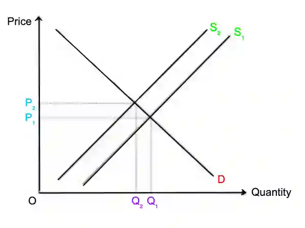

# 0455/22/M/J/24

## Question 1

**1(a)** $-3 \text{bn} + 0.6 \text{bn} = -2.4 \text{bn}$

**1(b)** A good tax must be efficient (the tax system should improve the performance of the market)and economical (tax revenue earned should be more than the cost to collect it).

**1(c)** The price is regulated to prevent monopolies exploiting their market power from increasing the price to a high level.

**1(d)** The government made more information about the labour market available to workers and employers, so workers would be informed about job vacancies and time spent searching for a job will be reduced. The government did not increase the unemployment benefit in line with inflation, so the incentive to work and earn income is increased.

**1(e)**

* **Relationship**: As change in the average wage rate increases, the inflation rate also increases.

* **Evidence**: In 2016-2017, both the change in average wage and inflation rate both rose. Between 2014-2018, the average wage rose quickly compared to the inflation rate, so the real wages would have increased between 2014-2018.

* **Explanation**: A higher inflation rate will encourage workers to press for higher wages.

**1(f)**

An increase in wage costs would increase the cost of production for firms, so the price may be raised.

**1(g)**

* The Tunisian government should continue to subsidise production of electricity because it reduces the cost of producing electricity, so firms can lower the price of electricity and making it more affordable. Costs of production for firms that use electricity will be lowered, which could encourage them to expand and produce more output.

* However, electricity firms may rely on the subsidy and become inefficient. Spending on subsides has an opportunity cost meaning that the government has to sacrifice on other public goods.

**1(h)**

* A rise in the value of the Tunisian dinar could benefit the Tunisian economy as it may reduce cost-push inflation (the rise in price level, where the value of the currency decreases). Imports would become relatively cheaper and exports would become relatively more expensive, allowing households to buy more imports. A rise in the value of the Tunisian dinar could increase confidence and attract MNCs.

* However, a rise in the value of the Tunisian dinar increases the price of exports so demand for exports decreases. Less exports may be sold and export revenue will decrease. Increased import expenditure could increase the trade deficit on the current account of Tunisia’s balance of payments. Additionally, low net exports may reduce the GDP.