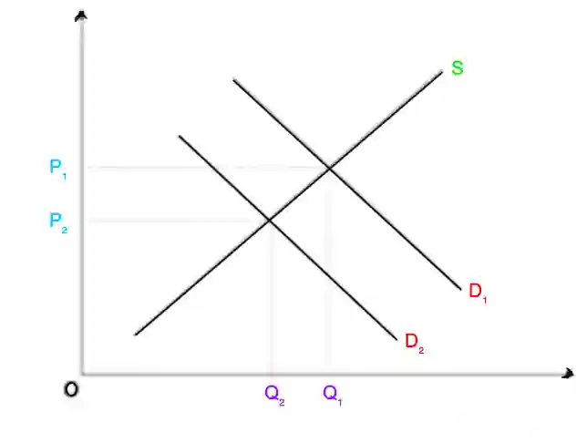

# 0455/22/M/J/23

## Question 1

**1(a)** 1100000 $\times \frac{35}{100}$ = 276500 people

**1(b)** Bad weather and fall in demand caused decrease in output of sugar.

**1(c)** Economic growth is measured in **real GDP** (value of goods and services produced in year, adjusted for inflation).

**1(d)** Increased spending on education may improve skills, increasing productivity and occupational mobility (ability to switch from one job to another). Cheaper rail travel may make it easier to work from areas further away, increasing geographical mobility. (ability to move from one geographical location to another).

**1(e)**

**1(f)**

* **Relationship**: The higher the GDP per head, the higher the internet access.

* **Evidence**: Iceland had the highest GDP per head and had the highest percentage of population with internet access. Eritrea had the lowest GDP per head and had the lowest percentage of population with internet access.

* **Analysis**: Higher GDP per head increases the ability of households to pay for internet access. Additionally, higher GDP per head increases tax revenues which can be spent on providing access to internet.

* **Exception**: Guyana had a higher GDP per head but lower internet access, compared to Morocco.

**1(g)**

* The discovery of oil may increase the living standards in Guyana as more oil can be extracted and exported to other countries, increasing economic growth. GDP (value of goods and services produced in a year) per head will increase so the purchasing power of individuals increases. Jobs related to oil extraction may be created, encouraging immigration from other countries.

* However, the discovery of oil may create external costs like pollution, damaging the environment and harming the health of the population.

**1(h)**

* Guyana might benefit from an increase in the size of its population as the population may move to the optimum level (number of people and resources/technology available are balanced) and factors of production could be utilised better. If the increase is due to immigration, new production methods and technology from other countries may be introduced.

* However, a larger population may cause pollution and damage the environment. If increase in population is too high, there may be overpopulation and resources may be depleted quickly.