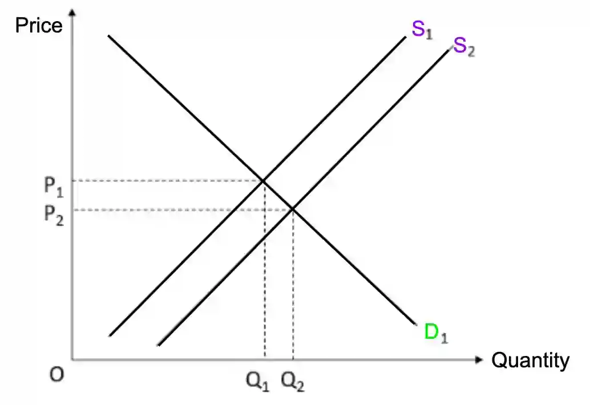

# 0455/22/M/J/25

## Question 1

**1(a)** *Budget deficit = government spending - government (tax) renenue.*

$310m $-$ $292m $=$ $18m

**1(b)** The factor of production land refers to the natural resources provided by nature. Examples are **beaches and rainforests**.

**1(c)** Tourism causes harm to those not directly involved in producing or consuming a product. This means that the social cost is greater than the private cost. An example of an external cost caused by tourism is the death of marine life.

**1(d)** There are high incomes in St. Kitts and Nevis, so the total demand for banking services (like opening savings accounts) will be high. If a foreign bank opens a branch in the country, it will have many customers and can earn more profit. The income tax rates in the country are low, so workers can keep more of the income they earn, workers may be more motivated and work harder. 

**1(e)** 

**1(f)**

* **Relationship:** As spending on healthcare increases, life expectancy increases.

* **Supporting evidence:** Haiti has the second lowest percentage healthcare spending and the shortest life expectancy. Canada and Sweden spend a high percentage on healthcare and have long life expectancies.

* **Analysis:** A higher spending on healthcare would likely improve the quality of healthcare provided and make the population healthier, enabling them to live longer.

* **Exception:** Monaco spends the lowest percentage on healthcare but has the longest life expectancy, possibly because of other factors such as nutrition and education.

**1(g)**

* An increase in the size of fishing industry of St. Kitts and Nevis would **reduce imports** of fish as more fish will be caught domestically. The fish caught can even be **exported** to other countries, **improving the current account balance** (create a surplus or reduce a deficit). Increasing the size of the industry would generate more **job opportunities** related to fishing, **increasing employment** and improving the overall living standards.

* The resources used to increase the size of the fishing industry St. Kitts and Nevis could be used in other profitable industry. This means that there is an **opportunity cost** to expanding the fishing industry. The fishing industry may deplete fish stocks by **overfishing**. This is harmful to the environment and will also raise the price of fish due to the shortage of fish.

1(h)

* *Deflation is a decrease in price level.* Deflation may have increased the real value of debt as it causes an increase in the value of each unit of money. Deflation creates uncertainty as the price level is not stable. Because of this, people become less confidence of future prospects and MNCs are discouraged from settling in the country.

* However, people have more purchasing power during a deflationary period - with the same income more products can be bought as the price of the products have gone down. Deflation is the result of increased total supply or total demand. If deflation is due to increased total supply, it may mean that advances in technology have lowered the cost of production, allowing producers to supply more.