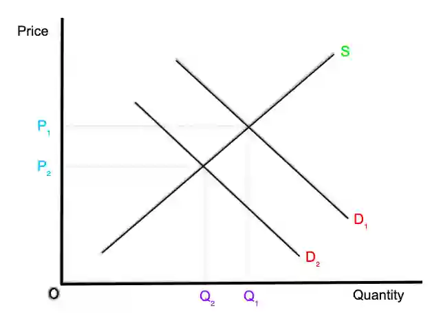

# 0455/22/F/M/23

## Question 1

**1(a)** Value of imports from China $=$ Imports of goods and services $\times$ (Imports from China as % of total imports $\div$ 100)

Value of imports from China $=$ $2800$ bn $\times \frac{20}{100}$ = $560bn

**1(b)** Increase in the quantity of factors of production in the US include land reclamation (increase in quantity of land) and increase in the labour force

**1(c)** Import tariffs are taxes imposed on imports. Import tariffs could raise tax revenue, which would improve the government budget position, which is the relationship between the government’s revenue and expenditure.

**1(d)** Inflation rate refers to the percentage increase in the price level of goods and services over a time period. Inflation can be classified as demand-pull inflation (caused due to increase in demand) and **cost-push inflation** (caused due to increase in cost of production). In 2020, the bargaining power of workers fell, so workers were not able to bargain for high wages. Lower wages meant the cost of production for firms fell and cost-pull inflation decreased. Additionally, in 2020 consumer expenditure fell. Consumer expenditure is a component of total demand, so total demand fell as well and **demand-pull inflation** fell.

**1(e)**

**1(f)**

* **Relationship**: The higher the government spending, the lower the unemployment rate.

* **Supporting evidence**: From 2015 to 2019, government spending increased by $700 bn and unemployment fell by 1.6%.

* **Analysis**: Government spending could have been on education and infrastructure. Job opportunities (such as teachers, construction workers) will be created and so unemployment may decrease.

* **Exception**: In 2020, both government spending and unemployment increased. During this year, government spending may have increased because of spending on more unemployment benefits.

**1(g)** Central banks use monetary policies to control the rate of inflation.

* Having a low inflation rate is beneficial as it can create **certainty** in the future. This may increase **confidence** in economic prospects, encouraging **investment**. Increased confidence also attracts **MNCs**. MNCs increase the quantity of goods/services produced and cause economic growth.

* However, low rates of inflation can turn into **deflation** (fall in price levels over a time period). This can lead to a **recession**, which is a period when the real GDP falls and the economic growth rate is negative.

**1(h)**

* Economic growth is the increase in quantity of goods and services produced, increasing real GDP. An increase in real GDP means an increase in the GDP per head (the country’s real GDP divided by its population) and income. This means that people have more money to spend and can enjoy more goods and services.

* However, income is not evenly distributed and there is widespread income inequality. Even with economic growth, people may continue to earn low incomes and have low living standards. For example, sick and disabled people may still struggle to pay for treatments and not benefit from economic growth.