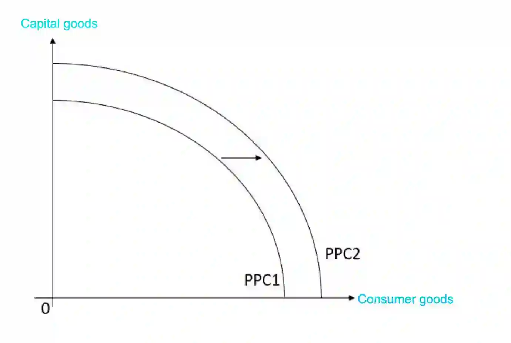

# 0455/21/O/N/24

## Question 1

**1(a)** percentage of foreign nationals living in UAE $=$ (foreign nationals living in UAE $\div$ population) $\times$ 100

percentage of foreign nationals living in UAE $= (\frac{8.9}{10}) \times 100 = 89\%$

**1(b)** Globalisation is the increased connection of people all over the world through migration and the sharing of ideas, which is made easier because of improvements in technology.

**1(c)** If there is good quality and affordable transport, workers can move from one location to another easily. For example, if air travel improves, more workers can be change locations.

**1(d)** When the price of a good that is price-inelastic in demand increases, the percentage by which price increases is more than the percentage change by which quantity demanded decreases. Revenue (quantity sold $\times$ price) increases. This is because the product may be a necessity so even if price increases, customers continue to buy the product because they need it. The disadvantage is that when the price of the same good decreases, the percentage by which price decreases is less than the percentage by which quantity demanded increases. This means that revenue earned from the product decreases. For example, a product may have a price inelasticity of demand of 0.4. When it’s price increases from 4 USD to 6 USD ($\frac{6-4}{4} \times 100 = 50\%$ increase in price), its quantity demanded drops from 1000 units to 800 units ($\frac{800-1000}{1000} \times 100 = 20\%$ decrease in quantity demanded). Revenue increases from 4 $\times$ 1000 $=$ 4000 USD to 6 $\times$ 800 $=$ 4800 USD, an increase of 800 USD. Taking the same good, if price decreases from 6 USD to 4 USD, revenue would fall by 800 USD.

**1(e)**

**1(f)**

* **Relationship**: As oil price increases, the current account balance also increases (they move in the same direction).

* **Evidence**: As the percentage change in the price of oil increases, the percentage change in the current account balance also increases.

* **Analysis**: As oil prices increase, more export revenue (quantity exported $\times$ price) is earned from exports. As export revenue increases, the current account balance increases.

**1(g)**

* Luxury tourism attracts tourists to Dubai, who spend on goods and services like food and travel. This increases economic growth as more firms will produce more good and services to increase supply to match the increased demand. As firms expand to increase supply, they might hire more workers so unemployed people can get a job, reducing unemployment.

* As more tourists visit Dubai, they use up large amounts of resources like water. They also travel through Dubai a lot which creates more vehicle exhaust, a source of pollution. This could cause health problems for people living in Dubai.

**1(h)** A fixed exchange rate is a system where the Central Bank of a country intervenes and fixes the price of their currency in relation to another currency.

* Having a fixed exchanger rate means that the currency will not increase or decrease. Consumers will be more confident as they know exactly how much the exchange rate is. Investors may invest more as they are confident in the economy.

* To maintain the foreign exchange rate of a currency, the Central Bank needs to buy and sell the currency. So the Central Bank needs to keep a reserve for of foreign currency. For example, if the exchange rate has fallen and they want it to rise so that it returns to its fixed exchange rate, the Central Bank would have to exchange foreign currency for the currency on the foreign exchange markets.