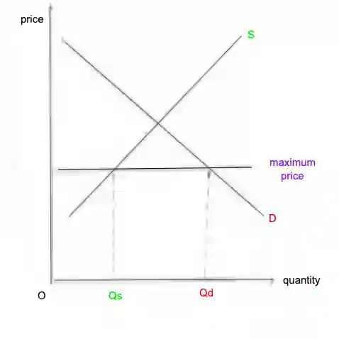

# 0455/21/M/J/23

**1(a)** unemployment rate $=$ (number of unemployed $\div$ labour force) $\times 100$

unemployment rate $= (0.56 \div 14.0) \times 100 = 4\%$

**1(b)** Substitutes for coal are gas and wind power, as they can be used instead of coal.

**1(c)** An economy of scale is the reduction in the average cost of firm due to increase in output produced. An example would be technical economies of scale, which involves using advanced technology like drones. This could make the firm work more efficiently, cutting down on the average cost.

**1(d)** It takes a **long** **time** to construct a new mine, which means that if there is an increase in price of coal, it will take a long time for firms to respond to this change and build new mines to produce coal. Because of the long time taken, coal has an inelastic supply. It is also **expensive to store coal**, so in order to cut down on costs, coal will not be stored for a long time. If price of coal increases, there is no stored coal that can be supplied so it has an inelastic supply.

**1(e)**

**1(f)**

* **Relationship**: Large coal producing companies may produce more coal than is required for consumption in their home countries, so may have a surplus of coal to sell.

* **Supporting evidence**: Five countries (US, Australia, Indonesia, Russia, South Africa) produce more coal than they consume. For example, the US consumes 660 tonnes of coal, but produces 671 tonnes, which means the country can export the 11 tonnes (671 $-$ 660) that they do not use.

* **Analysis**: Countries that produce large amounts of coal (have large coal industries) can charge low prices for their coal, which increases demand for coal exports and makes it easier to sell coal.

* **Exceptions**: China and India consumed more coal than they produced.

**1(g)**

* An increase in the size of the coal industry will cause more coal to be produced. Economic growth will occur as the quantity of goods (including coal) and services increases. More job vacancies relating to coal production will be created as the industry expands, so unemployed people can fill these positions so unemployment is reduced. Australia is a net exporter of coal (produces more coal than it consumees) so more coal can be exported to other countries. The export revenue earned can increase a surplus on the  current account.

* Coal mining may cause **pollution**, which may cause **health problems** and lower the **quality of life** of people living in Australia.

**1(h)** A budget deficit occurs when government spending exceeds government revenue.

* Unemployment is expected to increase in Australia, so the government may have to increase its spending on unemployment benefits. If more people are unemployed, less people are earning an income so less income tax revenue is earned. Additionally, as the population grows and people age, the government may have to spend more on pensions and healthcare, making it more likely for a budget deficit to occur.

* The population and labour force is also expected to increase so there may be more people will earn incomes and pay taxes. Firms may make greater profits in the 2026, so will have to pay more tax on their profits (corporation tax), making it less likely for a budget deficit to occur.