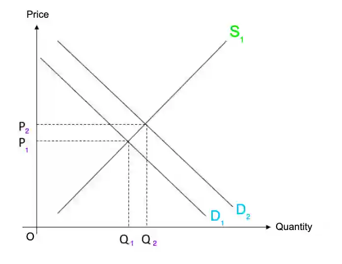

# 0455/22/F/M/24

## Question 1

**1(a)** $252 \text{bn} \div 3 \text{m}$ = $\$84000$

**1(b)** Opportunity costs of a Danish person using their leisure time to cycle include playing golf and jogging

**1(c)** One way by which living standards are measured is the **GDP per head**, as it influences the goods and services that one can afford to buy.

**1(d)** Supply of ships are price-inelastic, which means supply does not respond to prices in change by much. The ships take a long **time to be produced**, so the supply cannot be altered quickly. **Storage of ships** is expensive, so the inventory will be low. If prices fall, ships will have to be sold instead of stored.

**1(e)**

* **Relationship**: As government spending increases, GDP also tends to increase.

* **Evidence**: From 2015 to 2018, government spending and GDP increased. Government spending increased over the period - GDP was the lowest at the start of the period (2015) and highest at the end of the period (2018)

* **Analysis**: Higher government spending will increase total demand, which will contribute to the GDP. Additionally, increase in government spending may be due to spending on education or healthcare which can lead to higher productivity.

* **Exception**: 2018-2019, government spending increased in this period, but GDP fell. This may because when GDP falls, the government will spend more to try to raise GDP

**1(f)**

Higher birth rates would increase the demand for toys as there will be more children for parents to buy toys for. This will raise its price of toys.

**1(g)**

* A surplus on the current account of its balance of payments might benefit the Danish economy as exports would exceed imports, and this will be added to the total demand, increasing GDP. The surplus could cause an increase in employment and incomes. Additionally, it may an indication of a strong economy, attracting foreign investments.

* However, it might not benefit the Danish economy as a surplus indicates that consumer choice may be limited and depletion of resources. Demand-pull inflation may increase, which is harmful if the unemployment rate is very low. Demand for the currency will be greater than supply for the currency, which will raise the exchange rate. The international competitiveness of the exports will fall, reducing the surplus in the long run.

**1(h)**

* More people working from home might benefit the economy as workers may be less tired and stressed, raising productivity. More people may be able to work, increasing the quantity of labour. Pollution due to travel will decrease, reducing external costs and improving health of workers. Firms will be able to cut down costs as large office spaces will not be needed. Additionally, conflict between workers may lessen, reducing the chance of industrial action.

* The economy might not be benefited by more people working from home, as less people will be travelling, leading to unemployment of bus or taxi drivers. Restaurants may be forced to shut down, creating unemployment. Workers may not focus on their work, because they are not being supervised, causing a decrease in productivity.