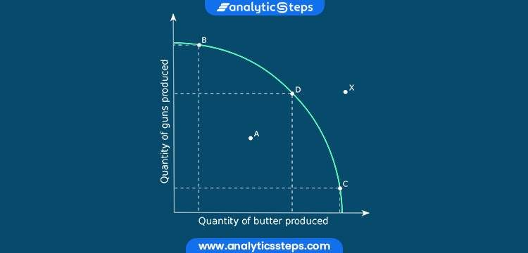
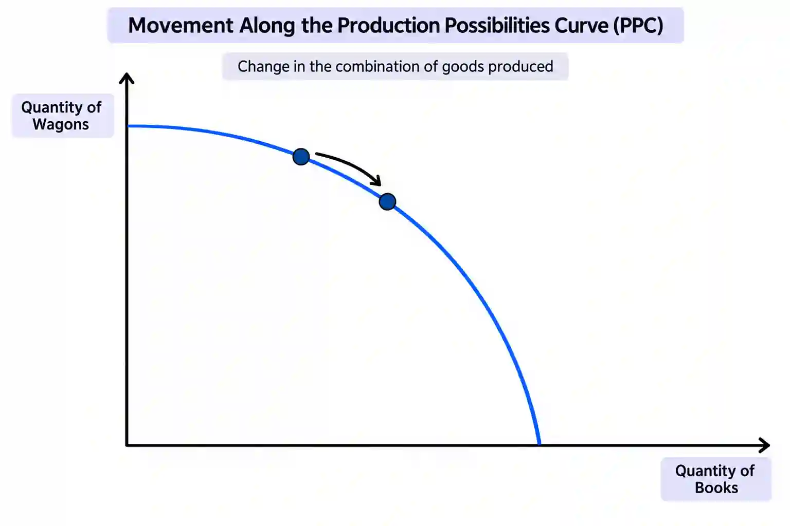

## Production Possibility Curves (PPC)

* The Production Possibility Curve (PPC) considers the **maximum possible output** a country can achieve upon using all factors of production to produce only **two** goods/services, in each time period with its limited resources. It can show opportunity cost (discussed earlier).
* A lot of the PPCs use Capital Goods & Consumer Goods.
  * Capital Goods are goods that are used to **produce other goods and services** and are not directly consumed by individuals. Examples - Machines, factories, equipment etc.

  * Whereas Consumer Goods are goods that are **directly consumed by individuals** to satisfy their wants and needs. Examples - Clothes, cars, food etc.

* The point labelled ‘X’ inside the curve above shows inefficiency. Inefficiency occurs when an **economy is not using its resources to their full potential**.

* The point labelled ‘Y’ outside the curve is **not achievable** due to **scarcity** of required resources.

* With changes, the PPC can end up **moving** or **shifting**.

#|
||

**Movement in PPC**

|

**Shift in PPC**

||
||

A movement in the PPC occurs when an economy **reallocates resources** between the production of two goods, shifting from one combination to another on the **same curve**.

|

A shift in the PPC occurs when an economy's productive capacity changes, meaning it can **produce more or less of both goods**. This is different from a movement along the PPC, which only reallocates existing resources.

||
|#

### Shifts in PPC - A shift in a PPC shows a CHANGE in the productive capacity.

Outward Shift - An outward shift would mean an economy can produce more of both goods.

Outward Shift Causes -

* Increase in Quantity of Factors of Production (Land, Labor, Capital, Enterprise)

* Improvement in Quality of Factors of Production (Better education/training, improved healthcare and technology)

The result of this would be economic growth and higher potential output.

Inward Shift - An inward shift indicates the economy can produce less of both goods.

Inward Shift Causes -

* Decrease in Factors of Production via emigration, natural disasters etc.

* Fall in Productivity (Due to poor education/training, poor health of workers etc.)

The result of this would be an economic decline and lower productive capacity.

Uneven Shift - One good increases more than the other.

Uneven shift causes - Improvement affects only one sector.

Example - Better farming technology = more food production only, but won’t shift other goods.

Note:  PPCs assume all resources are fully and efficiently used.