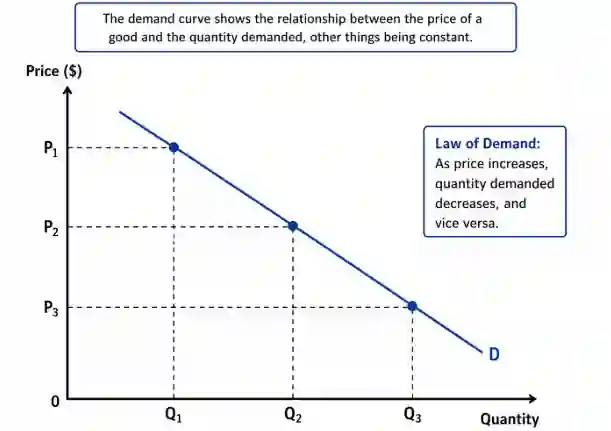

## Demand

**Demand** refers to the quantity of a good or service that consumers are **willing and able** to buy at **different prices** over a specific period of time. This is what a demand curve looks like:

* **Demand is inversely proportional to price**

* Highest price of a good = fewer people demand that good

$$
\text{Demand} \propto \frac{1}{Price}
$$

**Example**: Let’s take a pen

* If a pen is selling for $2, 100 people are willing to buy it.

* If the price of the pen falls from 2 Dollars to 1 Dollar, the **quantity demanded** increases from **100 pens to 180 pens**. This is a **movement along the same demand curve** from one point to another because the **only factor changing is the price of the pen**.

* Since only the price has changed, there is **no shift in the demand curve**. Instead, there is an **extension (increase) in quantity demanded**, represented by a movement downward along the demand curve.

**Link Between individual and market demand in terms of aggregation -**

Individual demand refers to the quantity of a good demanded by one consumer at different prices, while Market demand is the total demand for a good by all consumers in the market and is obtained by **aggregating (totaling) the individual demand curves of all consumers** at each price.

### **Movement Along A Demand Curve**

* Movement along a demand curve occurs when there is a change in the **price** of the good or service, while all other factors remain constant (ceteris paribus - A Latin phrase meaning **"all other things being equal."**).

* **Example** - If income levels increase, demand for luxury cars may rise, **ceteris paribus** assuming car prices and other factors remain the same.

**Contraction in QD (Upward Movement on the Curve)**

* This occurs when **price increases**, leading to a **decrease in quantity demanded**.

* In the diagram, moving from **point A to point B** represents a contraction.

* Since price is higher, fewer consumers are willing or able to buy the product.

**Extension in QD (Downward Movement on the Curve)**

* This occurs when **price decreases**, leading to an **increase in quantity demanded**.

* In the diagram, moving from **point B to point A** represents an extension.

* Since the price is lower, more consumers are willing or able to buy the product.

### **Shift In The Demand Curve -**

**Rightward Shift (Increase in Demand)**

* The demand curve shifts from **D to D2**, meaning that at the same price ($12), the quantity demanded increases from **80 to 115**.

* This suggests a **higher willingness to buy the product at all price levels**.

**Leftward Shift (Decrease in Demand)**

* If the demand curve shifts **leftward** (opposite of the diagram), demand decreases at all price levels.
* Its causes include Fall in Income (Normal Goods), Fall in Population, Change in Tastes and Preferences, Fall in Prices of Substitute Goods, Rise in Prices of Complementary Goods etc.

### **Factors that affect demand**

* Change in Income

* Change in Tastes and Fashion

* Improved Advertising and Branding

* Changes in the Prices of Substitutes (Alternatives)

* Changes in the Prices of Complementary goods

* Changes in Population Size or Distribution

**Expectations of Future Prices (Demand) -**

**If consumers expect prices to fall in the future, current demand decreases, causing a leftward shift of the demand curve. For example -** If consumers expect the price of mobile phones to fall due to new models being released, they delay their purchases, reducing current demand.

### Factors Causing Shifts of the Demand Curve

**An change in the following factors will change at all prices, causing a shift of the demand curve -**

* **Income (for Normal Goods)** - When income changes, consumers have **greater or lesser purchasing power**. They are able and willing to buy more or less goods and services.

* **Population** - An increase or decrease in population means **more or less consumers in the market**. This raises or lowers the total demand for goods and services.

* **Tastes and Preferences** - If a product becomes more fashionable or desirable, consumers prefer it. More consumers choose to buy the product, raising demand.

* **Prices of Substitute Goods** - A change in the price of a substitute makes the good **relatively cheaper or more expensive**. Consumers switch away from the substitute towards the good, or vice versa.