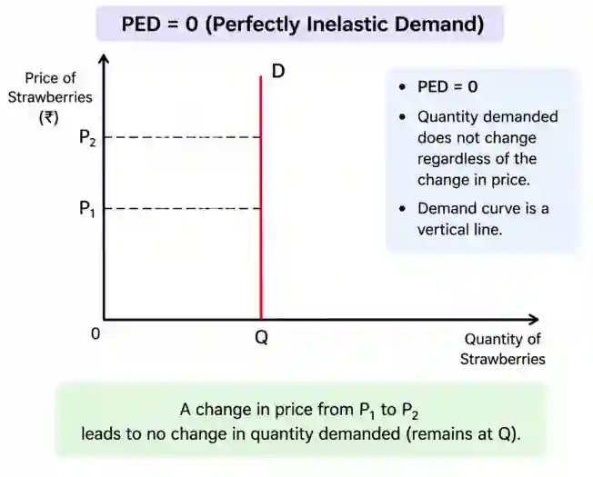
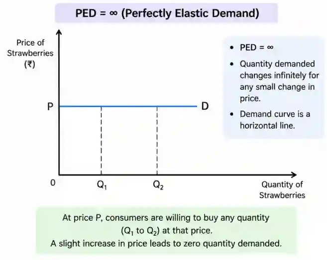

## Price Elasticity of Demand (PED)

**Definition:** Measure of responsiveness of a **change in quantity demanded to a change in price.**

Relationship between PED and Total Revenue (TR)

Total Revenue (TR) = **Price × Quantity Sold**

The effect of a price change on total revenue depends on the price elasticity of demand.

#|
||

PED

|

If Price Increases

|

If Price Decreases

||
||

Elastic (PED$>$1)

|

Total Revenue Decreases

|

Total Revenue Increases

||
||

Inelastic (PED$<$1)

|

Total Revenue Increases

|

Total Revenue Decreases

||
||

Unitary Elastic (PED$=$1)

|

Total Revenue Remains Unchanged

|

Total Revenue Remains Unchanged

||
|#

**Examples -**

#### Elastic Demand (PED \> 1)

Suppose a coffee shop increases the price of coffee from **5 Dollars to 6 Dollars**.

* Many customers switch to another café.

* Quantity demanded falls by a greater percentage than the price rises.

* Therefore, **total revenue falls**.

### Inelastic Demand (PED \< 1)

If the price of petrol decreases from 2.20 Dollars to 2 Dollars, quantity demanded will increase only slightly because petrol is a necessity. The percentage increase in quantity demanded is smaller than the percentage decrease in price. Therefore, the total revenue decreases.

### Unitary Elastic Demand (PED = 1)

* Price increases by 10% = Quantity demanded decreases by 10% = Total Revenue remains unchanged

* Price decreases by 10% = Quantity demanded increases by 10% = Total Revenue remains unchanged.

* With unitary elastic demand, the percentage change in quantity demanded is exactly the same as the percentage change in price. Therefore, the total revenue remains unchanged.

  **Formula** to calculate PED.

It basically measures how sensitive consumers are to a change in price, by showing how much quantity demanded changes when price falls or increases.

$$
\text{PED} =\frac{\text{Percentage Change in Quantity Demanded}}{\text{Percentage Change in Price}}
$$

After applying the PED formula, there can be 5 outcomes.

* **PED \> 1** = Price Elastic = Percentage change in quantity demanded is more than change in price.

  

* **PED \< 1** = Price Inelastic = Percentage change in quantity demanded is lesser than change in price.

  

* **PED = 1** = Unitary Elastic = Percentage change in quantity demanded is equal to change in price

  

* **PED = 0** = Perfectly Inelastic = Quantity demanded does not change at all when price changes

  

* **PED = ∞ (Infinity)** = Perfectly Elastic = Consumers will buy any quantity at one particular price, but demand falls to zero if price rises

  

**Factors that determine PED -**

#|
||

**Factor**

|

**Elastic PED**

|

**Inelastic PED**

||
||

**Availability of Substitutes**

|

Many Substitutes

|

Few or No Substitutes

||
||

**Proportion of Income**

|

Large Proportion

|

Smaller Proportion

||
||

**Luxury or Necessity Good**

|

Luxury Good

|

Necessity Good

||
||

**Level of Addictiveness of Product**

|

Barely or Not Addictive

|

Highly Addictive

||
||

**Time Period**

|

Long Run

|

Short Run

||
|#

### **Example of Elastic PED & Inelastic PED**

**Elastic PED**

* A product has many substitutes. Therefore, it has elastic PED because **consumers will switch to substitutes the moment there is even the slightest of change in price**.

  * Example - Coca Cola’s price changes from $1.6 \text{to} $1.8$, so people switch to Pepsi which serves a similar purpose for a cheaper price.

**Inelastic PED**

* A product has few or no substitutes. Therefore, it has inelastic PED since **consumers who are using a product with no substitutes will have to keep using the same product** despite a change in price, since they can’t switch to another one due to its unavailability.

**Mnemonic to remember the factors that affect PED**

**S**mart **P**eople **L**earn **A**bout **T**ime

* **S**ubstitues’ Availability

* **P**roportion of Income

* **L**uxury or Necessity Good

* **A**ddictiveness of Product

* **T**ime Period

PED & Total Spending on a Product/Revenue -

Total spending (total revenue) is the total amount spent by consumers on a product, which is equal to ‘Price × Quantity sold’.

### Significance of Price Elasticity of Demand (PED) -

Price elasticity of demand is significant because it helps **firms and governments predict how consumers will respond to price changes** and make better decisions. By using it, they are successfully able to avoid potentional future losses and are able to adjust to the market easily.