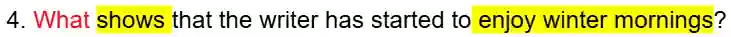
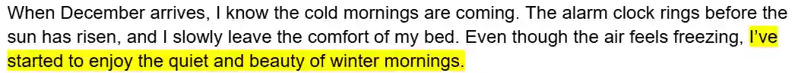
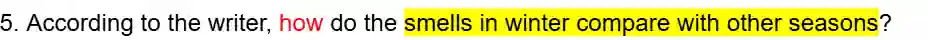
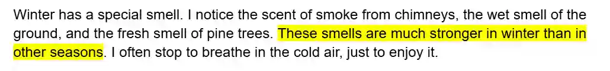
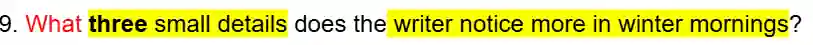
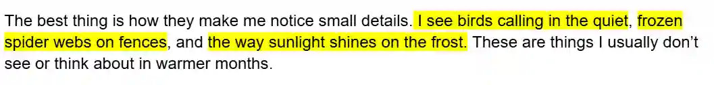

## Tips

* Do not worry if you find more than 3 answers in the text for the last question, sometimes there might be 4 or 5 answers. Just pick any 3 and write them down. the mark scheme will be like:

  * “Any 3 of the following 4/5/answers”

* Copy-paste answers from the text. Do **not** change the words

  Ex:

  

  

  So, the answer is *"I’ve started to enjoy the quiet and beauty"*

  

  

  So, the answer is *“They are stronger / more noticeable”*

* For the “List” questions, give the 1st answer in 1st line, then 2nd answer in 2nd line, and so on. Do this even if the answer is really short

  Ex:

  

  

  So, the answers are:

* *Birds calling in the quiet*

* *Frozen spider webs*

* *Sunlight shining on the frost*

### Method to gain maximum marks: (apply for all exercises)

* **Skim** the text first. **Do not** underline or mark anything.

* Then read the questions and **mark/ underline the key words** (including the ‘wh’ words).

* **Scan** the text. Then mark/underline **in the text** where the answer is.

* Then write down the answer.