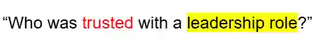
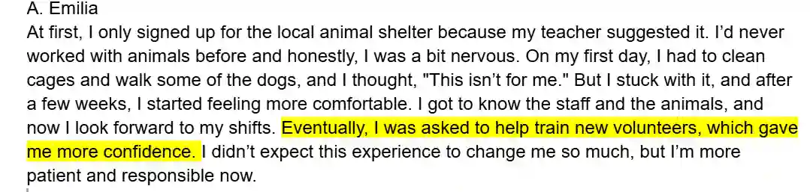
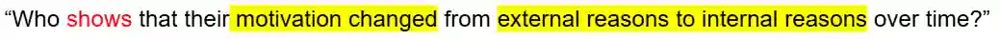
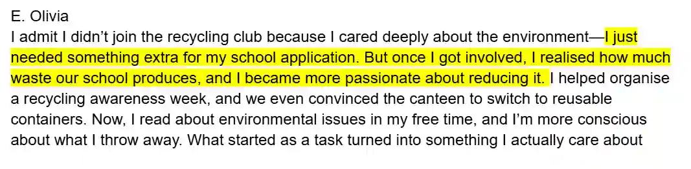
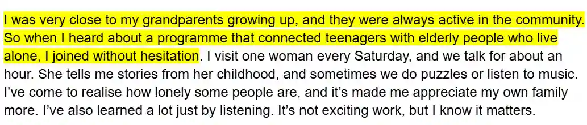

## Method to gain maximum marks: (apply for all exercises)

* **Skim** the text first. **Do not** underline or mark anything.

* Then read the questions and **mark/ underline the key words** (including the ‘wh’ words).

* **Scan** the text. Then mark/underline **in the text** where the answer is.

* Then write down the letter.

* The answer will be **implied not directly given** so look where similar text is.

### Example

In the first text,

This **indirectly** says she was given a leadership role (training new volunteers)

So, the answer is **A**

This shows she shifted from *external reasons* (something for school) to an *internal reason* (more passionate about reducing waste)

So, the answer is **E**

* Pay attention to the **first word** in the question- **‘felt unsure’**, **‘was influenced’**, **‘considers**’, **‘was surprised’**, **‘showed’**. This will make it easier to look for the answer. Look for synonyms for that word/phrase

**Ex:**

**Notice** *‘was influenced’*

**By what?** - *‘by family values’*

So, look for the person that **connects these 2 ideas** such as;

Their grandparents have a history of community work (such as volunteering). So, the answer is C.