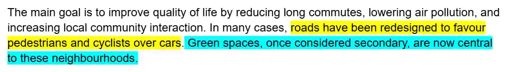
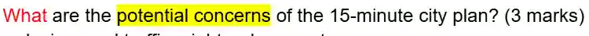
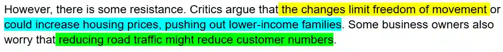

### Tips

* Do not worry if you find more than 3 answers in the text, sometimes there might be 4 or 5 answer. Just pick any 3 and write them down. the mark scheme will be like:

  * “Any 3 of the following 4/5/answers”

* Copy-paste answers from the text. Try not to change the words

  **Ex:**

  

  there would be 2 blank bullet points. So, you need to write 2 points, one answer is each line **only**. Do **not** exceed the line given.

  

  So, the answers are

  * *roads are made to favor pedestrian and cyclists*

  * *green spaces are made more central*

* Include a **noun** and a **verb** in **every answer**

  **Ex:**

  

  there would be 2 blank bullet points. So, you need to write 2 points, one answer is each line **only**. Do **not** exceed the line given.

  

  So, the answers are

  * *reducing road traffic might reduce customers*

  * *freedom of movement is limited*

  * *lower-income families could be pushed out due to higher housing prices*

  ### **Method to gain maximum marks: (apply for all exercises)**

* **Skim** the text first. **Do not** underline or mark anything.

* Then read the questions and **mark/ underline the key words** (including the ‘wh’ words).

* **Scan** the text. Then mark/underline **in the text** where the answer is.

* Then write down the answer.