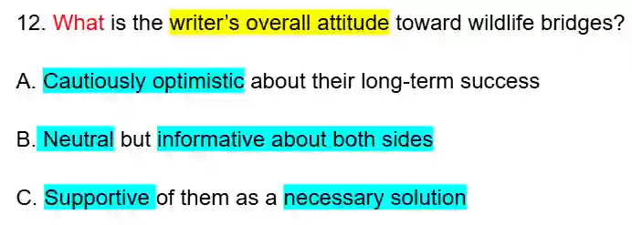
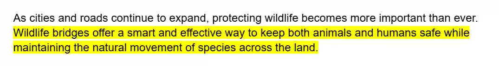
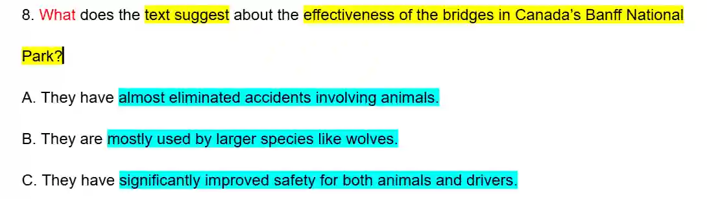
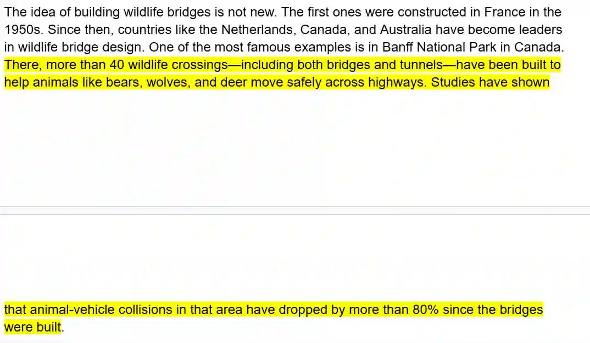

## Tips

* When you have questions that are based on the author’s overall opinion of the text, read each option and try to find supporting evidence of that answer in the text.

* These questions are usually the hardest so be careful.

**Ex:**

A-*no evidence*

B-*no evidence*

So, answer is **C**

Also, look out for questions where you need to understand an idea instead of the answer directly given in the text

Ex:

A-*accidents are not **completely** gone*

B-*nothing is specified about **only** large animals using the bridges*

C-*This matches the wording “dropped by more than 80%,” which means **a major, significant improvement**, not near-total elimination.*

So, **C** is the answer