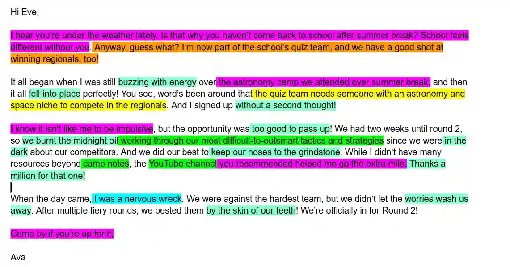

## Dissection of the sample email

**Key:**

Pink-personalization

Yellow-attending the first prompt

Green-attending the second prompt

Blue- attending the third prompt

Turquoise- figurative language

Orange-connecting to the first prompt

**Note:** “the extra mile”, “a good shot” are all figurative language