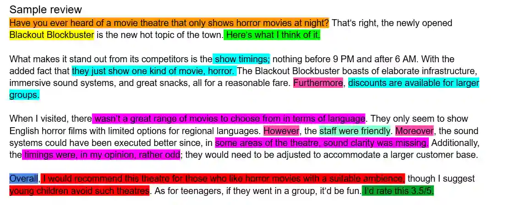

## Dissection of sample review

**Key:**

Orange- hook

Yellow- name of subject (theater)

Light green- stating that this purely my own opinion

Light blue-main points in describing the theater

Purple-main points on what i think about the theater (negative)

Turquoise- main points on what i think about the theater (positive)

Pink- linking words

Dark blue- signalling the end (also linking word)

Red- who I would recommend this theater to and who i would not recommend this theater to.

Dark green- rating 