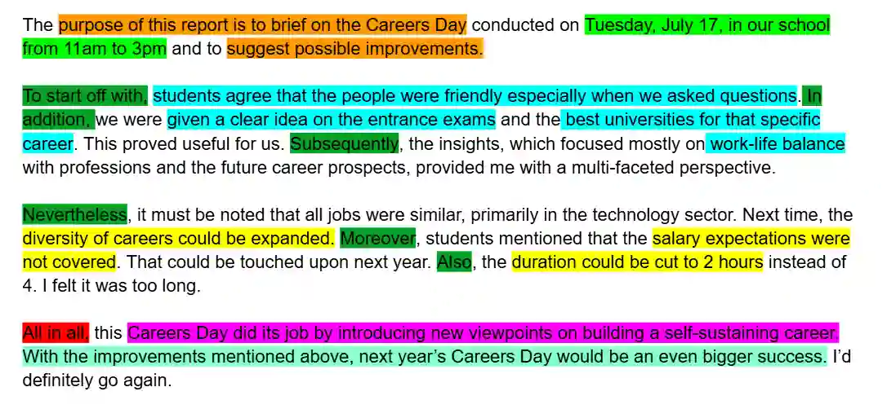

## Dissection of the sample report

**Key**:

Orange- purpose of report

Light green-further details (stating what happened)

Blue- addressing the first bold point in the question

Yellow- addressing the second bold point in the question

Pink- summarizing body paragraph 1

Turquoise- summarizing body paragraph 2

Dark green-linking words

Red- signaling the end (also a linking word)