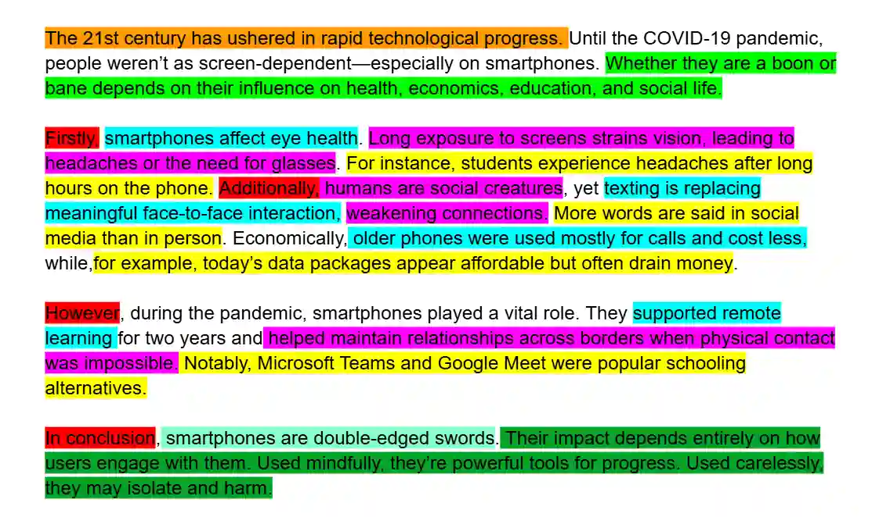

## Dissection of the sample essay

**Key**:

Orange- broad background statement

Light green- aspects though which you are going to assess this topic (also this is the thesis statement- route 2)

Blue- topic sentence

Pink-reason

Yellow- example

Turquoise- settling for the final opinion

Dark green- repeating the overall ideas discussed in the body paragraph

Red- linking words