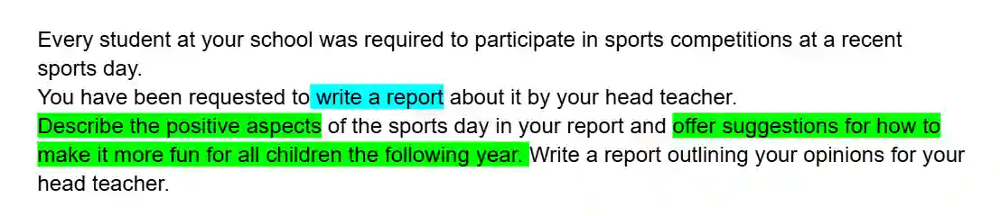
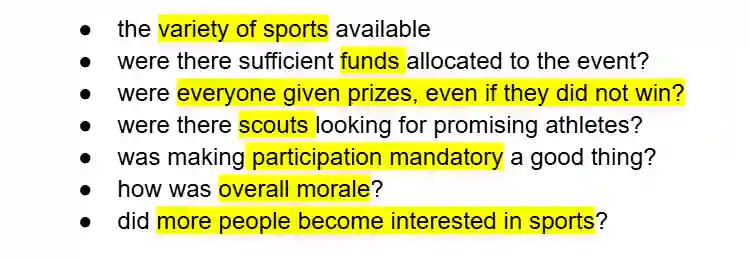

## Lenses

* Can use this to get ideas for content in ex-6

* involves looking at the same question/ topic in different points of view

**Example question**

Possible lenses could include

* the lenses could **differ from person to person**