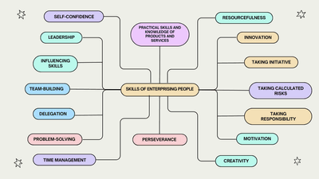

# Enterprise Skills
## Skills of Enterprising People
### **Enterprising Attributes**

### **Identifying and Evaluating Enterprising Skills**
 
- Not all entrepreneurs have all the enterprising skills. 
  - Some of them are innate or developed.
  - Entrepreneurs should be able to identify which attributes are their strengths or weaknesses and which ones they can build upon.
  - Enterprising people use their skills in various combinations wherever needed.