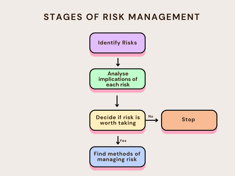
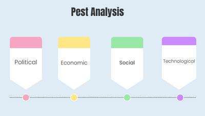

## Risks

**Risk** is possibility of a gaining or loosing something as result of an action or decision taken.

### **Types of Risks:**

1. **Economic risk.** E.g. Inflation, changes in income or interests rates.

2. **Human resource risk.** E.g. whether or not there are the right number of people employed and do they have the right skills needed.

3. **Financial risk.** E.g. savings being used to build enterprise, not enough funds to run business.

4. **Health and safety environment risks.**

5. **Production risk.** E.g. machinery failure or inability to access the right materials needed.

### **Steps of Risk Management:**

1. **Identify Risks-** Use PEST or SWOT(Strengths, weaknesses, opportunities and threats)  analysis.

2. **Analyse the implications of each risk.** (List out the possible gains or losses and how great would the result be.)

- Balance out possible negative and positive outcomes against each other.

3. **Decide if risk is worth taking.** (If rewards are greater than losses then its likely for risk to be taken. Entrepreneurs attitude towards risks can also influence their decision).

4. **Methods of Managing Risks:** 

                                                            MATE

- **Mitigate:** Reducing the likelihood or severity of the risk.
- **Accept:** If nothing can be done about the risk, make a plan to be prepared to deal with its effects.
- **Transfer:** Letting the risk be handled by people in an external organization.
- **Eliminate:** Avoid or don't go ahead with the risk.

### **Attitudes to Risks:**

1. **Risk-keen:** when a person is willing to take risk.

2. **Risk-averse:** when a person tries to avoid any kind of risk.

3. **Risk-reducer**: when a person tries to limit the likelihood of risk.

(**Note**: Decision in regards of risks are often influenced by the type of attitude a person has when dealing with risks.)