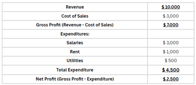
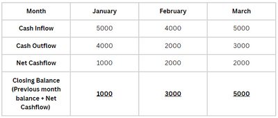

## Financial Records

### **Why is it important for an enterprise to have accurate financial records?**

1. Helps understand the possible position of the enterprise in the future and aids in planning activities accordingly.

2. Can be used to come up with goals which motivates employees as they know what they are working towards.

3. Helps understand current financial position of enterprise. (Profit or loss, surplus or deficit)

4. For some enterprises, maintaining accurate records is a legal requirement to determine the amount of tax owed.

5. Aids owners and shareholders in understanding the profit or loss of an enterprise and how much they are expected get back in return as dividends.

6. Can help prospective investors make a just comparison about the business and other similar ones so if its worth investing into.

### Structure of an Income Statement:

- Formula:
  - Gross profit = Revenue - Cost of Sales
  - Net profit = Gross Profit - Expenditures

### Structure of an Cash Flow Statement:

